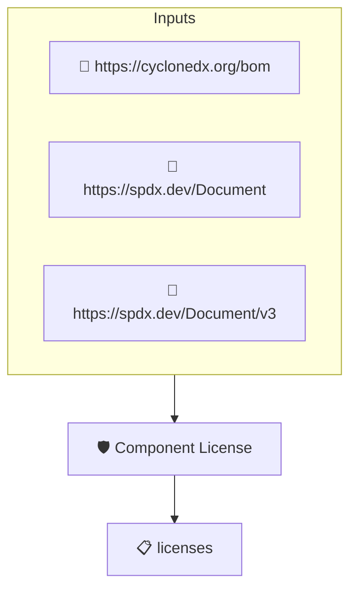

# Component License

Checks that the top level components of the SBOM carry license
information. This implements the _Component License_ element of
the CISA 2026 SBOM Minimum Elements.

The check accepts declared license lists or a concluded license on
each root component. Explicit unknown markers (such as SPDX
NOASSERTION) satisfy the element, as CISA requires unknown license
information to be explicitly indicated rather than omitted.

This policy only checks for the presence of license data. To
enforce that licenses are OSI/FSF approved, pair it with
sbom-licenses-are-foss.

## Overview

| Property | Value |
|----------|-------|
| **Type** | Policy |
| **ID** | `PROTOBOM-SBOM-LICENSES` |
| **Assert mode** | AND |
| **Tenets** | 1 |
| **Enforce** | ON |

## Structure



## Tenets

### Tenet: `licenses`

**Evaluation:**
```cel
size(outputs.licenses) > 0 && outputs.licenses.all(l, size(l) > 0 && l.all(x, x != ''))
```

**Outputs:**
- `licenses`: `size(sboms) > 0 ? sboms[0].get_node_list().get_root_nodes().map(n, size(n.lic...`

**On pass:** All top level components carry license information

**On fail:** One or more top level components carry no license information
**Guidance:** Add license identifiers to each top level component or explicitly mark the license as unknown

