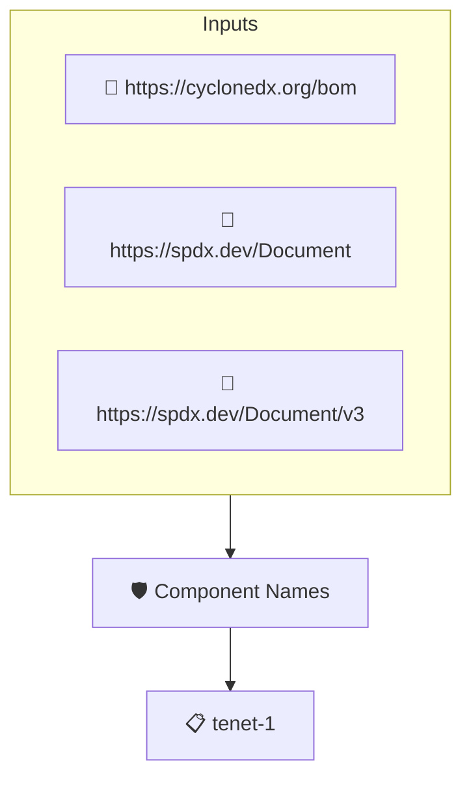

# Component Names

Checks that every top-level component of the SBOM has a name. The SBOM is read through protobom, so SPDX and CycloneDX documents are handled alike.

## Overview

| Property | Value |
|----------|-------|
| **Type** | Policy |
| **ID** | `PROTOBOM-NAME` |
| **Assert mode** | AND |
| **Tenets** | 1 |
| **Enforce** | ON |

## Structure



## Tenets

### Tenet: `tenet-1`

**Evaluation:**
```cel
outputs.names.all(s, s != "")
```

**Outputs:**
- `names`: `sboms[0].get_node_list().get_root_nodes().map(s, s.name)`

**On pass:** Top level components have their name set

