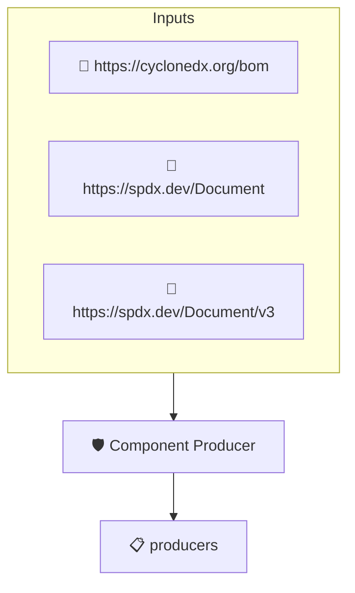

# Component Producer

Checks that the top level components of the SBOM identify the
entity that created them. This implements the _Component Producer_
element of the CISA 2026 SBOM Minimum Elements, which replaces the
2021 _Supplier Name_ element.

The check looks at each root component's originators and falls
back to its suppliers, as most SBOM generators record the
producing entity in the supplier field.

Note: protobom reads CycloneDX component suppliers since ampel
v1.3.7. On older releases CycloneDX SBOMs fail this check even
when the component supplier is set.

## Overview

| Property | Value |
|----------|-------|
| **Type** | Policy |
| **ID** | `PROTOBOM-SBOM-PRODUCERS` |
| **Assert mode** | AND |
| **Tenets** | 1 |
| **Enforce** | ON |

## Structure



## Tenets

### Tenet: `producers`

**Evaluation:**
```cel
size(outputs.producers) > 0 && outputs.producers.all(p, size(p) > 0 && p.all(e, e.name != ''))
```

**Outputs:**
- `producers`: `size(sboms) > 0 ? sboms[0].get_node_list().get_root_nodes().map(n, size(n.ori...`

**On pass:** All top level components identify their producer

**On fail:** One or more top level components do not identify the entity that produced them
**Guidance:** Set the originator (SPDX) or supplier of each top level component, or explicitly mark it as of unknown provenance

