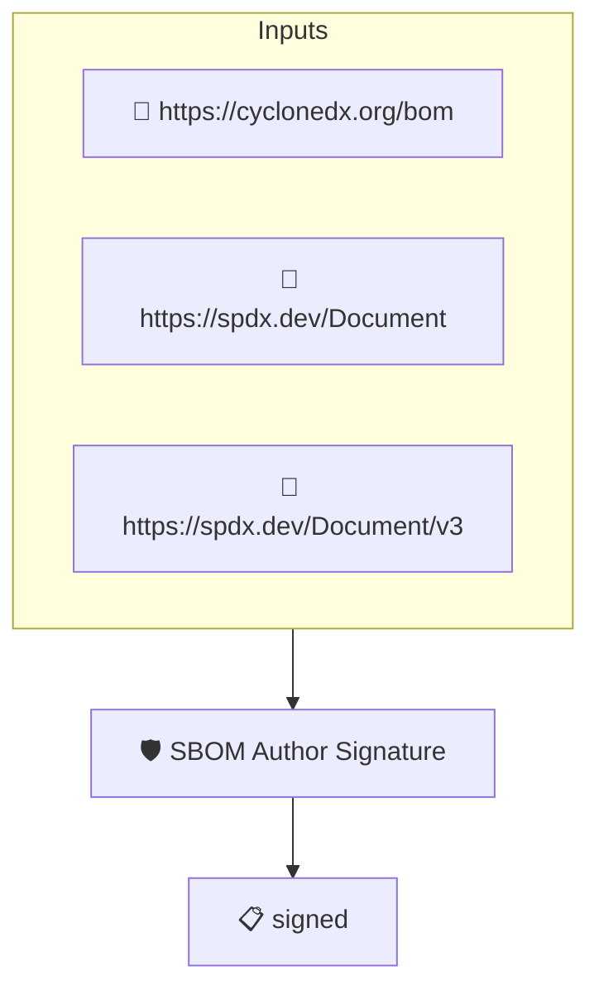

# SBOM Author Signature

Checks that the SBOM was ingested from a signed attestation and that
AMPEL verified its signature. This implements the _SBOM Author
Signature_ element of the CISA 2026 SBOM Minimum Elements.

Note that this policy checks the signature on the attestation
envelope wrapping the SBOM, not data inside the SBOM document
itself (neither SPDX nor CycloneDX embed author signatures).

This standalone policy enforces the signature requirement. As most
SBOMs are still distributed unsigned, the CISA-SBOM-2026 group
carries it with enforce OFF to make the check advisory; set
`enforce: OFF` (or pin author identities) to match that behavior.

## Overview

| Property | Value |
|----------|-------|
| **Type** | Policy |
| **ID** | `PROTOBOM-SBOM-SIGNED` |
| **Assert mode** | AND |
| **Tenets** | 1 |
| **Enforce** | ON |

## Structure



## Tenets

### Tenet: `signed`

**Evaluation:**
```cel
size(predicates) > 0 && predicates.all(p, size(p.verification.signers) > 0)
```

**On pass:** SBOM attestation signature verified

**On fail:** The SBOM attestation is not signed or its signature could not be verified
**Guidance:** Distribute the SBOM wrapped in a signed attestation (for example a sigstore bundle) attributable to the SBOM author

