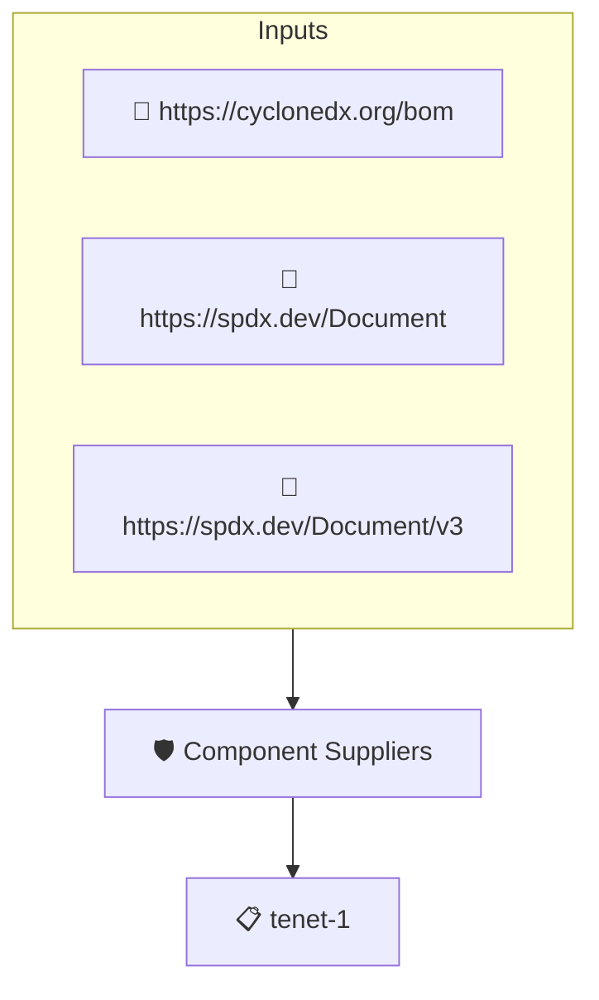

# Component Suppliers

Checks that every top-level component of the SBOM names its supplier. The SBOM is read through protobom, so SPDX and CycloneDX documents are handled alike.

## Overview

| Property | Value |
|----------|-------|
| **Type** | Policy |
| **ID** | `PROTOBOM-SUPPLIERS` |
| **Assert mode** | AND |
| **Tenets** | 1 |
| **Enforce** | ON |

## Structure



## Tenets

### Tenet: `tenet-1`

**Evaluation:**
```cel
outputs.suppliers.all(s, size(s) > 0)
```

**Outputs:**
- `suppliers`: `sboms[0].get_node_list().get_root_nodes().map(n, n.suppliers)`

**On pass:** All top level components have supplier info

