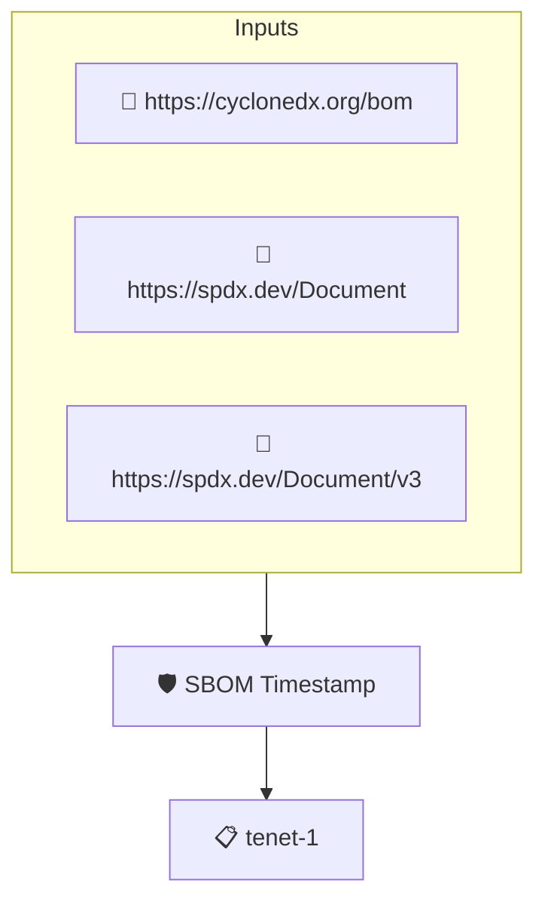

# SBOM Timestamp

Checks that the SBOM records when it was generated. The SBOM is read through protobom, so SPDX and CycloneDX documents are handled alike.

## Overview

| Property | Value |
|----------|-------|
| **Type** | Policy |
| **ID** | `PROTOBOM-TIMESTAMP` |
| **Assert mode** | AND |
| **Tenets** | 1 |
| **Enforce** | ON |

## Structure



## Tenets

### Tenet: `tenet-1`

**Evaluation:**
```cel
int(outputs.date) > 0
```

**Outputs:**
- `date`: `size(sboms) > 0 ? sboms[0].get_metadata().date : null`

**On pass:** SBOM contains a timestamp

