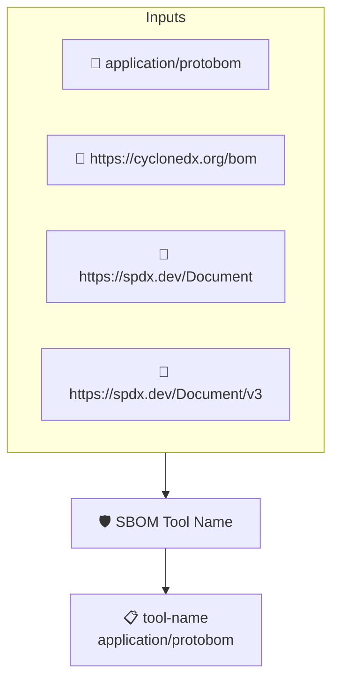

# SBOM Tool Name

Checks that the SBOM records the name of the tool used to generate
it. This implements the _SBOM Tool Name_ element of the CISA 2026
SBOM Minimum Elements.

This policy uses the protobom transformer because the tool
metadata is only reachable through the transformed predicate.

Note: protobom does not yet populate the tools collection when
reading CycloneDX documents, so CycloneDX SBOMs currently fail
this check even when `metadata.tools` is set.

## Overview

| Property | Value |
|----------|-------|
| **Type** | Policy |
| **ID** | `PROTOBOM-SBOM-TOOL-NAME` |
| **Assert mode** | AND |
| **Tenets** | 1 |
| **Enforce** | ON |

## Structure



## Tenets

### Tenet: `tool-name`

**Attestation types:**
- `application/protobom`

**Evaluation:**
```cel
size(outputs.tools) > 0 && outputs.tools.all(t, has(t.name) && t.name != '')
```

**Outputs:**
- `tools`: `size(predicates) > 0 && has(predicates[0].data.metadata.tools) ? predicates[0...`

**On pass:** SBOM records the tool that generated it

**On fail:** The SBOM does not record the name of the tool that generated it
**Guidance:** Record the generator in the SBOM metadata (SPDX Tool creator or CycloneDX metadata.tools)

