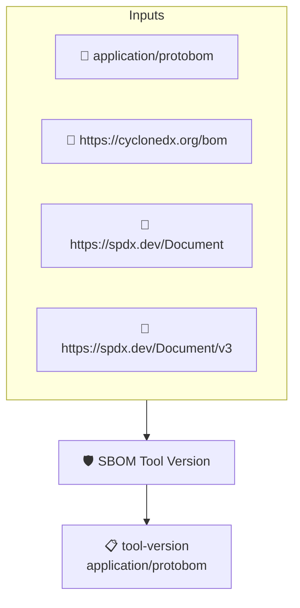

# SBOM Tool Version

Checks that the SBOM records the version of the tool used to
generate it. This implements the _SBOM Tool Version_ element of
the CISA 2026 SBOM Minimum Elements.

SPDX encodes the tool version in the creator string by convention
(`Tool: name-version`) and protobom does not yet split it out, so
a tool entry also passes when its name embeds a version.

This policy uses the protobom transformer because the tool
metadata is only reachable through the transformed predicate.

Note: protobom does not yet populate the tools collection when
reading CycloneDX documents, so CycloneDX SBOMs currently fail
this check even when `metadata.tools` is set.

## Overview

| Property | Value |
|----------|-------|
| **Type** | Policy |
| **ID** | `PROTOBOM-SBOM-TOOL-VERSION` |
| **Assert mode** | AND |
| **Tenets** | 1 |
| **Enforce** | ON |

## Structure



## Tenets

### Tenet: `tool-version`

**Attestation types:**
- `application/protobom`

**Evaluation:**
```cel
size(outputs.tools) > 0 && outputs.tools.all(t, (has(t.version) && t.version != '') || (has(t.name) && t.name.matches('.*[-_/ ]v?[0-9].*')))
```

**Outputs:**
- `tools`: `size(predicates) > 0 && has(predicates[0].data.metadata.tools) ? predicates[0...`

**On pass:** SBOM records the version of the tool that generated it

**On fail:** The SBOM does not record the version of the tool that generated it
**Guidance:** Record the generator version in the SBOM metadata (SPDX Tool creator string or CycloneDX metadata.tools)

