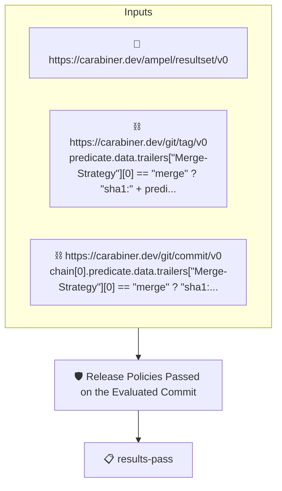

# Release Policies Passed on the Evaluated Commit

Passes when the commit the release policies were evaluated on, the
pull request's head, carries an AMPEL results attestation whose
verdict is PASS.

The policy reaches that commit from the tag through git wherever
git can give it: for a merge commit the evaluated head is the
merge's second parent, read from the tagged commit's own
attestation (`https://carabiner.dev/git/commit/v0`). A squash or
a rebase rewrites history and leaves no link, so for those the
chain reads the tag's `Evaluated-Commit` trailer, the one place
the trailer is load-bearing. `Merge-Strategy` says which path
applies. The tenets then evaluate on the head, reading the
results attestation (`https://carabiner.dev/ampel/resultset/v0`)
the releaser stored for it. The head may no longer be on any
branch, so the collector must reach it through the pull request's
ref (`refs/pull/N/head` on GitHub) or by its sha.

Which releaser's results are trusted is AMPEL's decision, from
`--signer` or the policy's `identities`.

## Overview

| Property | Value |
|----------|-------|
| **Type** | Policy |
| **ID** | `release-evaluated-commit-passed` |
| **Assert mode** | AND |
| **Tenets** | 1 |
| **Enforce** | ON |

## Structure



## Tenets

### Tenet: `results-pass`

**Evaluation:**
```cel
predicates.exists(p, p.data.status == "PASS" && size(p.data.results) > 0)
```

**On pass:** The release policies passed on the evaluated commit

**On fail:** No passing results attestation for the evaluated commit
**Guidance:** The commit the release policies were evaluated on must carry a results attestation with at least one result and a PASS verdict, stored by the releaser at the time of the release.

