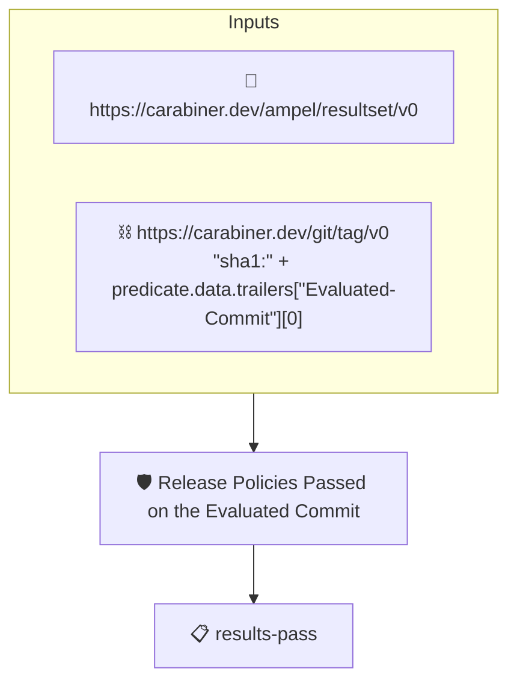

# Release Policies Passed on the Evaluated Commit

Passes when the commit the subject tag names in its
`Evaluated-Commit` trailer carries an AMPEL results attestation
whose verdict is PASS.

The policy follows the tag to the evaluated commit through the
tag attestation (`https://carabiner.dev/git/tag/v0`): the chain's
selector reads the trailer and the tenets then evaluate on that
commit, reading the results attestation
(`https://carabiner.dev/ampel/resultset/v0`) the releaser stored
for it. The evaluated commit may no longer be on any branch (a
squash or a rebase leaves it behind), so the collector reading the
results must reach it, through the pull request's ref
(`refs/pull/N/head` on GitHub) or by its sha.

Which releaser's results are trusted is AMPEL's decision, from
`--signer` or the policy's `identities`.

## Overview

| Property | Value |
|----------|-------|
| **Type** | Policy |
| **ID** | `release-evaluated-commit-passed` |
| **Assert mode** | AND |
| **Tenets** | 1 |
| **Enforce** | ON |

## Structure



## Tenets

### Tenet: `results-pass`

**Evaluation:**
```cel
predicates.exists(p, p.data.status == "PASS" && size(p.data.results) > 0)
```

**On pass:** The release policies passed on the evaluated commit

**On fail:** No passing results attestation for the evaluated commit
**Guidance:** The commit the tag names as evaluated must carry a results attestation with at least one result and a PASS verdict, stored by the releaser at the time of the release.

