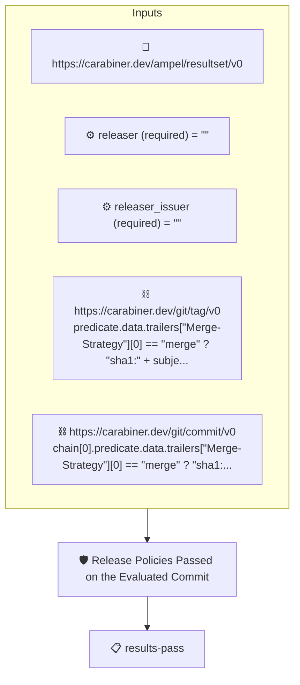

# Release Policies Passed on the Evaluated Commit

Passes when the commit the release policies were evaluated on, the
pull request's head, carries an AMPEL results attestation whose
verdict is PASS, signed by the releaser.

The subject is the tagged commit; the evaluation results live on
the head. The policy reaches the head through git wherever git can
give it: for a merge commit the evaluated head is the merge's
second parent, read from the tagged commit's own attestation
(`https://carabiner.dev/git/commit/v0`). A squash or a rebase
rewrites history and leaves no link, so for those the chain reads
the tag's `Evaluated-Commit` trailer, the one place the trailer
is load-bearing. `Merge-Strategy` says which path applies. The
tenet then reads the results attestation
(`https://carabiner.dev/ampel/resultset/v0`) the releaser stored
for the head and requires a PASS verdict signed by the releaser
named in the `releaser` and `releaser_issuer` context values.
The head may no longer be on any branch, so the collectors must
reach it: the git collector fetches it on demand, the dynamic note
collector serves its note by sha.

## Overview

| Property | Value |
|----------|-------|
| **Type** | Policy |
| **ID** | `release-evaluated-commit-passed` |
| **Assert mode** | AND |
| **Tenets** | 1 |
| **Enforce** | ON |

## Context Values

| Name | Type | Required | Default |
|------|------|----------|---------|
| `releaser` |  | **yes** | `` |
| `releaser_issuer` |  | **yes** | `` |

## Structure



## Tenets

### Tenet: `results-pass`

**Evaluation:**
```cel
predicates.exists(p, p.data.status == "PASS" && size(p.data.results) > 0 &&
    p.verification.verified &&
    p.verification.signers.exists(s, has(s.sigstore) &&
        s.sigstore.identity == context.releaser &&
        s.sigstore.issuer == context.releaser_issuer))
```

**On pass:** The release policies passed on the evaluated commit, as the releaser recorded

**On fail:** No passing results attestation from the releaser for the evaluated commit
**Guidance:** The commit the release policies were evaluated on must carry a results attestation with at least one result and a PASS verdict, signed by the releaser given as the releaser and releaser_issuer context values.

