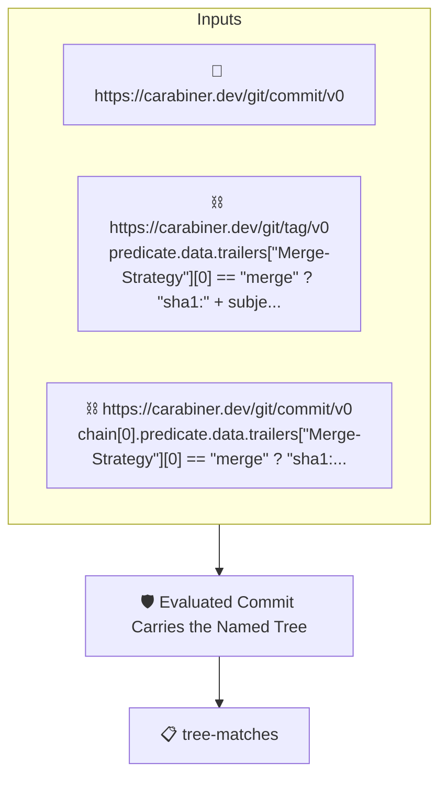

# Evaluated Commit Carries the Named Tree

Passes when the commit the release policies were evaluated on
carries the tree the tag's `Tree` trailer names.

The subject is the tagged commit. The evaluated commit is reached
as `release-evaluated-commit-passed` reaches it: the merge's
second parent for a merge commit, the `Evaluated-Commit` trailer
for a squash or a rebase. Its tree, read from its attestation
(`https://carabiner.dev/git/commit/v0`), must be the one the tag
names. With `release-tagged-commit-tree` this establishes that
the tagged commit and the evaluated commit carry the same tree:
what was released is what was evaluated.

## Overview

| Property | Value |
|----------|-------|
| **Type** | Policy |
| **ID** | `release-evaluated-commit-tree` |
| **Assert mode** | AND |
| **Tenets** | 1 |
| **Enforce** | ON |

## Structure



## Tenets

### Tenet: `tree-matches`

**Evaluation:**
```cel
predicate.data.tree == chain[0].predicate.data.trailers["Tree"][0]
```

**On pass:** The evaluated commit carries the tree the tag names

**On fail:** The evaluated commit does not carry the tree the tag names
**Guidance:** The release tag's Tree trailer must name the evaluated commit's tree, the content the policies passed on.

