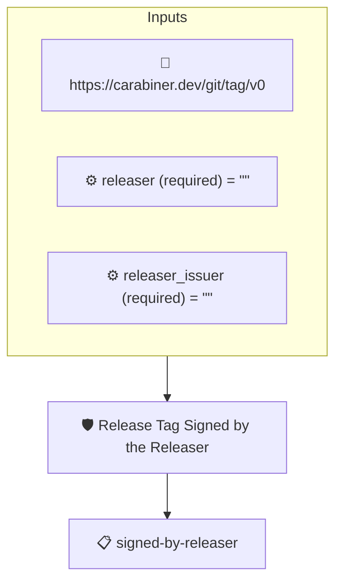

# Release Tag Signed by the Releaser

Passes when the subject commit is the target of an annotated tag
whose signature verifies and whose signer is the releaser named
in the context: miniprow's keyless identity, for a tag it cut.

The subject is the **tagged commit**, what a builder checks out at
the tag. The tag is the releaser's claim that the release policies
passed on the evaluated commit and that the tagged commit carries
the evaluated tree; the claim is worth exactly as much as the
signature on it. The evidence is the git tag attestation
(`https://carabiner.dev/git/tag/v0`) the carabiner git collector
synthesizes from the tag object, which names both the tag and the
commit it points at as subjects; its verification is the tag's own
signature, checked by the collector: sigstore against the Fulcio
chain and the Rekor log, or PGP against the keys it holds. The
tenet requires that verification and matches its signer against
the `releaser` and `releaser_issuer` context values, so the
releaser is pinned by whoever runs the verification, not baked
into the policy, and no `--signer` constraint is needed on the
run (one would wrongly constrain the git objects the sibling
policies chain through).

## Verifying

```
ampel verify --subject-hash sha1:<tagged commit> \\
    -c git:https://github.com/ORG/REPO@v1.2.0 \\
    -p git+https://github.com/carabiner-dev/policies#release/release-tag-signed.json \\
    --context releaser:<releaser identity> \\
    --context releaser_issuer:<its OIDC issuer>
```

## Overview

| Property | Value |
|----------|-------|
| **Type** | Policy |
| **ID** | `release-tag-signed` |
| **Assert mode** | AND |
| **Tenets** | 1 |
| **Enforce** | ON |

## Context Values

| Name | Type | Required | Default |
|------|------|----------|---------|
| `releaser` |  | **yes** | `` |
| `releaser_issuer` |  | **yes** | `` |

## Structure



## Tenets

### Tenet: `signed-by-releaser`

**Evaluation:**
```cel
predicates.exists(p, p.verification.verified &&
    p.verification.signers.exists(s, has(s.sigstore) &&
        s.sigstore.identity == context.releaser &&
        s.sigstore.issuer == context.releaser_issuer))
```

**On pass:** The tag is signed by the releaser

**On fail:** The tag is not signed by the releaser
**Guidance:** The tag on this commit must carry a verified signature whose sigstore identity and issuer are the releaser's, given as the releaser and releaser_issuer context values. An unsigned tag, a PGP-signed one, or another signer is not a release by this releaser.

