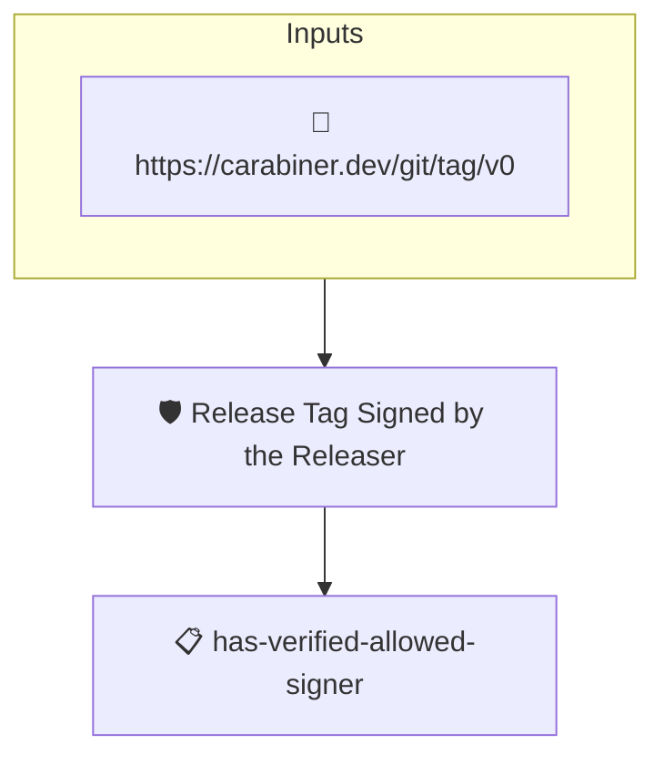

# Release Tag Signed by the Releaser

Passes when the subject git tag carries a verified signature from
an accepted signer: the releaser, such as miniprow's sigstore
identity.

The tag is the releaser's claim that the release policies passed
on the evaluated commit and that the tagged commit carries the
evaluated tree. The claim is worth exactly as much as the
signature on it, so this policy requires the tag attestation's
verification to be set, verified, and matched to a sigstore
identity. Which identity is accepted is AMPEL's decision, from
`--signer` or the policy's `identities`; this tenet rejects an
empty match and a key or reference identity.

The git tag attestation (`https://carabiner.dev/git/tag/v0`) is
synthesized by the carabiner git collector from the tag object;
its verification is the tag's own signature, checked by the
collector.

## Verifying

```
ampel verify --subject-hash sha1:<tag object sha> \
    -c git:https://github.com/ORG/REPO@v1.2.0 \
    -p git+https://github.com/carabiner-dev/policies#release/release-tag-signed.json \
    --signer 'sigstore::https://token.actions.githubusercontent.com::<releaser identity>'
```

## Overview

| Property | Value |
|----------|-------|
| **Type** | Policy |
| **ID** | `release-tag-signed` |
| **Assert mode** | AND |
| **Tenets** | 1 |
| **Enforce** | ON |

## Structure



## Tenets

### Tenet: `has-verified-allowed-signer`

**Evaluation:**
```cel
predicates.exists(p,
    p.verification.verified &&
    size(p.verification.identities) > 0 &&
    p.verification.identities.all(i, has(i.sigstore))
)
```

**On pass:** The tag is signed by an accepted releaser

**On fail:** The tag is not signed by an accepted releaser
**Guidance:** The tag must carry a verified signature whose signer matches an accepted sigstore identity. Pass the releaser's identity with --signer 'sigstore::<issuer>::<identity>' or declare it in the policy; an unsigned tag, or one signed by a key or an unmatched identity, is rejected.

