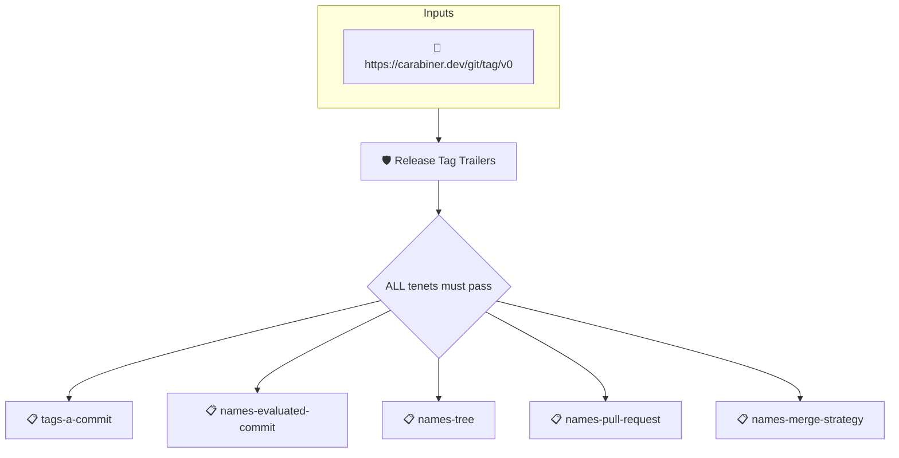

# Release Tag Trailers

Passes when the subject is an annotated git tag on a commit whose
message carries the trailers a release tag needs to be verified
back to the commit the policies were evaluated on.

A release tag cut by a tagger such as miniprow lands on the commit
the merge produced, while the policies were evaluated on the pull
request's head. The tag's trailers are the signed link between the
two: `Evaluated-Commit` names the head, `Tree` the tree both
commits share, `Pull-Request` the pull request, and
`Merge-Strategy` how the head reached the branch. This policy
checks the trailers are present and well formed; the other
policies in the `release-tag` set follow them.

The tag is described by a git tag attestation
(`https://carabiner.dev/git/tag/v0`), synthesized by the carabiner
git collector from the tag object itself with the message's
trailers parsed as git defines them.

## Overview

| Property | Value |
|----------|-------|
| **Type** | Policy |
| **ID** | `release-tag-trailers` |
| **Assert mode** | AND |
| **Tenets** | 5 |
| **Enforce** | ON |

## Structure



## Tenets

### Tenet: `tags-a-commit`

**Evaluation:**
```cel
predicate.data.objectType == "commit"
```

**On pass:** The tag points at a commit

**On fail:** The tag does not point at a commit
**Guidance:** A release tag must point at the commit the release is cut from, not at another tag, a tree or a blob.

### Tenet: `names-evaluated-commit`

**Evaluation:**
```cel
has(predicate.data.trailers) &&
"Evaluated-Commit" in predicate.data.trailers &&
predicate.data.trailers["Evaluated-Commit"].size() == 1 &&
predicate.data.trailers["Evaluated-Commit"][0].matches("^[0-9a-f]{40}$")
```

**On pass:** The tag names the commit the policies were evaluated on

**On fail:** The tag does not name the evaluated commit
**Guidance:** The tag message must end with exactly one `Evaluated-Commit: <sha>` trailer naming the commit the release policies were evaluated on, as a full 40-character sha.

### Tenet: `names-tree`

**Evaluation:**
```cel
has(predicate.data.trailers) &&
"Tree" in predicate.data.trailers &&
predicate.data.trailers["Tree"].size() == 1 &&
predicate.data.trailers["Tree"][0].matches("^[0-9a-f]{40}$")
```

**On pass:** The tag names the tree the tagged and the evaluated commits share

**On fail:** The tag does not name the released tree
**Guidance:** The tag message must end with exactly one `Tree: <sha>` trailer naming the tree both the tagged commit and the evaluated commit carry.

### Tenet: `names-pull-request`

**Evaluation:**
```cel
has(predicate.data.trailers) &&
"Pull-Request" in predicate.data.trailers &&
predicate.data.trailers["Pull-Request"].size() == 1 &&
predicate.data.trailers["Pull-Request"][0].matches("^[1-9][0-9]*$")
```

**On pass:** The tag names the pull request the release came from

**On fail:** The tag does not name the pull request
**Guidance:** The tag message must end with exactly one `Pull-Request: <number>` trailer. A squashed or rebased head is only reachable through the pull request's ref, so a verifier needs the number.

### Tenet: `names-merge-strategy`

**Evaluation:**
```cel
has(predicate.data.trailers) &&
"Merge-Strategy" in predicate.data.trailers &&
predicate.data.trailers["Merge-Strategy"][0] in ["merge", "squash", "rebase"]
```

**On pass:** The tag states how the evaluated commit reached the branch

**On fail:** The tag does not state a known merge strategy
**Guidance:** The tag message must end with a `Merge-Strategy: merge|squash|rebase` trailer.

