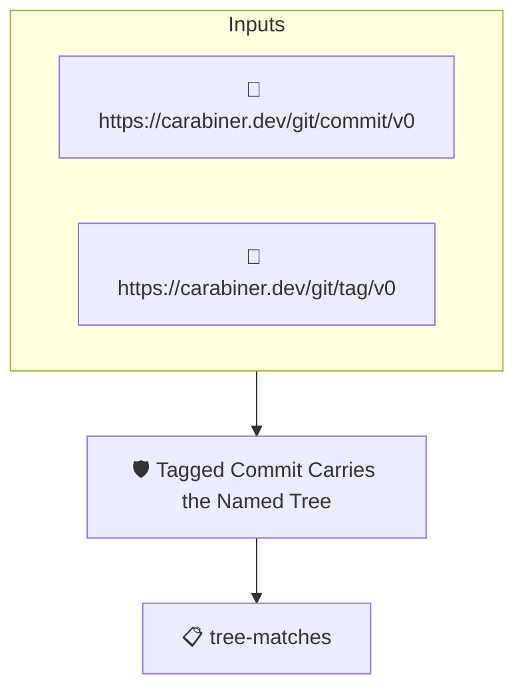

# Tagged Commit Carries the Named Tree

Passes when the subject commit, the one the release tag points at,
carries the tree the tag's `Tree` trailer names.

A release tag lands on the commit a merge produced while the
policies were evaluated on the pull request's head; what makes
the tag honest is that both commits carry the same tree. The tag
names that tree in its signed `Tree` trailer. Both the tag
attestation (`https://carabiner.dev/git/tag/v0`) and the commit's
own attestation (`https://carabiner.dev/git/commit/v0`, synthesized
from the commit object) are evidence about the subject, so the
tenet compares them directly. Its sibling
`release-evaluated-commit-tree` does the same for the evaluated
commit; together they establish the two trees are one.

## Overview

| Property | Value |
|----------|-------|
| **Type** | Policy |
| **ID** | `release-tagged-commit-tree` |
| **Assert mode** | AND |
| **Tenets** | 1 |
| **Enforce** | ON |

## Structure



## Tenets

### Tenet: `tree-matches`

**Evaluation:**
```cel
predicates.exists(t, t.predicate_type == "https://carabiner.dev/git/tag/v0" &&
    predicates.exists(c, c.predicate_type == "https://carabiner.dev/git/commit/v0" &&
        c.data.tree == t.data.trailers["Tree"][0]))
```

**On pass:** The tagged commit carries the tree the tag names

**On fail:** The tagged commit does not carry the tree the tag names
**Guidance:** The release tag's Tree trailer must name the tagged commit's tree. A tag whose target carries another tree was cut on content the policies never saw.

