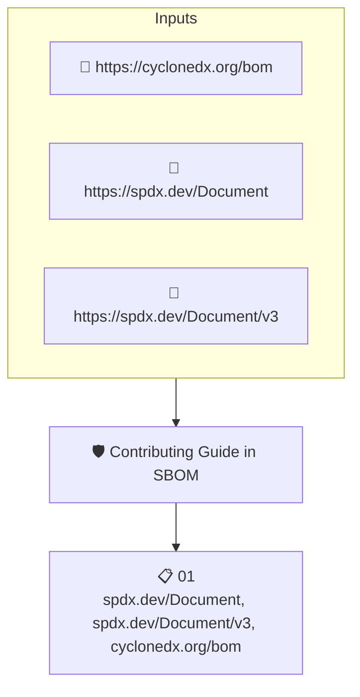

# Contributing Guide in SBOM

Looks through the files listed in the project's SBOM for a `CONTRIBUTING.md` file and fails when none is found.

## Overview

| Property | Value |
|----------|-------|
| **Type** | Policy |
| **ID** | `sbom-contains-contributing-md` |
| **Assert mode** | AND |
| **Tenets** | 1 |
| **Enforce** | ON |

## Structure



## Tenets

### Tenet: `01`

**Attestation types:**
- `https://spdx.dev/Document`
- `https://spdx.dev/Document/v3`
- `https://cyclonedx.org/bom`

**Evaluation:**
```cel
size(outputs['files']) > 0
```

**Outputs:**
- `files`: `sboms[0].get_node_list().get_nodes().filter(n, n.name == "CONTRIBUTING.md")`

**On pass:** Found a CONTRIBUTING.md file

**On fail:** Repository has no CONTRIBUTING.md file
**Guidance:** Write up the project's contribution process into a CONTRIBUTING.md file and check it into the repository.

