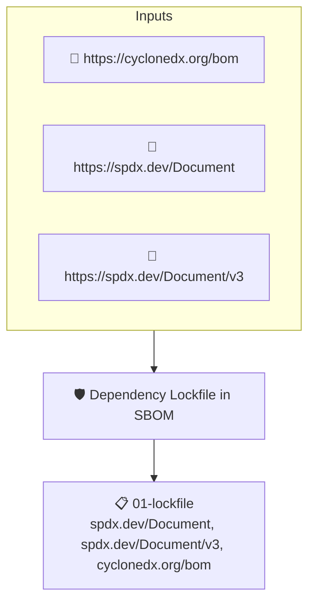

# Dependency Lockfile in SBOM

Looks through the files listed in the project's SBOM for a language dependency lockfile, such as those of Go, Python, npm or Ruby tooling, and fails when none is found.

## Overview

| Property | Value |
|----------|-------|
| **Type** | Policy |
| **ID** | `sbom-contains-lockfile` |
| **Assert mode** | AND |
| **Tenets** | 1 |
| **Enforce** | ON |

## Structure



## Tenets

### Tenet: `01-lockfile`

**Attestation types:**
- `https://spdx.dev/Document`
- `https://spdx.dev/Document/v3`
- `https://cyclonedx.org/bom`

**Evaluation:**
```cel
size(outputs["files"]) > 0
```

**Outputs:**
- `files`: `sboms[0].get_node_list().get_nodes().filter(n, (n.name == 'requirements.txt' ...`

**On pass:** Found a package lock file

**On fail:** Could not detect a package lock file
**Guidance:** Ensure your project uses go, pypy, npm or ruby gems tooling o handle dependencies

