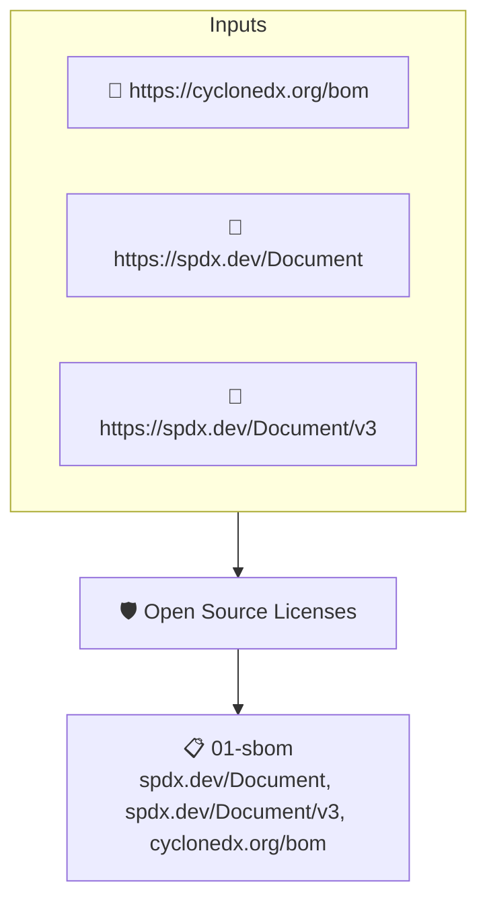

# Open Source Licenses

Checks that the top-level components of the SBOM declare licenses and that those licenses are approved by the OSI or the FSF.

## Overview

| Property | Value |
|----------|-------|
| **Type** | Policy |
| **ID** | `sbom-licenses-are-foss` |
| **Assert mode** | AND |
| **Tenets** | 1 |
| **Enforce** | ON |

## Structure



## Tenets

### Tenet: `01-sbom`

**Attestation types:**
- `https://spdx.dev/Document`
- `https://spdx.dev/Document/v3`
- `https://cyclonedx.org/bom`

**Evaluation:**
```cel
outputs.licenses.all(license, license in outputs.license_list) && size(outputs.licenses) > 0
```

**Outputs:**
- `license_list`: `['0BSD', 'AAL', 'AFL-1.1', 'AFL-1.2', 'AFL-2.0', 'AFL-2.1', 'AFL-3.0', 'AGPL-...`
- `licenses`: `sboms[0].get_node_list().get_nodes().filter(n, size(n.licenses) > 0).map(n, n...`
- `licenses_test`: `['AFL-2.1', 'Apache-2.0']`

**On pass:** Found a license file in the project's SBOM.

**On fail:** No licenses found in SBOM or licenses are not OSI approved
**Guidance:** Ensure your SBOM has license info and that the licenses are OSI approved

