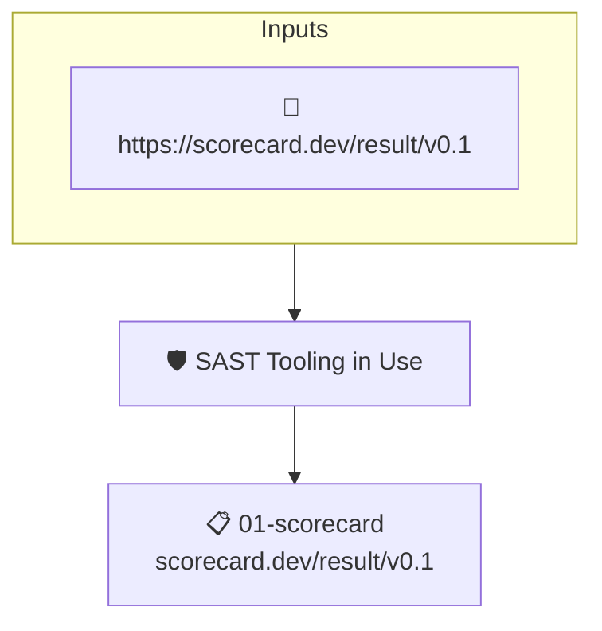

# SAST Tooling in Use

Reads the project's attested [OpenSSF Scorecard](https://scorecard.dev) results. Fails when Scorecard did not detect a static application security testing tool running on the project.

## Overview

| Property | Value |
|----------|-------|
| **Type** | Policy |
| **ID** | `SCORECARD-SAST` |
| **Assert mode** | AND |
| **Tenets** | 1 |
| **Enforce** | ON |

## Structure



## Tenets

### Tenet: `01-scorecard`

**Attestation types:**
- `https://scorecard.dev/result/v0.1`

**Evaluation:**
```cel
size(outputs.sast) > 0 && outputs.sast.all(c, c.score == 10)
```

**Outputs:**
- `sast`: `has(predicates[0].data.checks) ? predicates[0].data.checks.filter(c, c.name =...`

**On pass:** Scorecard detected a SAST tool

**On fail:** Scorecard did not detect a SAST tool
**Guidance:** Configure a SAST tool like CodeQL in your repo and reattest the scorecard

