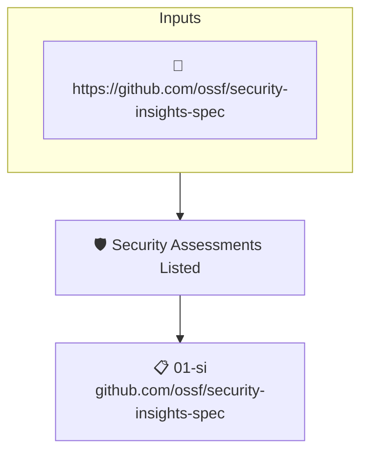

# Security Assessments Listed

Reads the project's attested [Security Insights](https://github.com/ossf/security-insights-spec) file. Fails when no security assessment is listed for the project.

## Overview

| Property | Value |
|----------|-------|
| **Type** | Policy |
| **ID** | `SI-ASSESSMENTS` |
| **Assert mode** | AND |
| **Tenets** | 1 |
| **Enforce** | ON |

## Structure



## Tenets

### Tenet: `01-si`

**Attestation types:**
- `https://github.com/ossf/security-insights-spec`

**Evaluation:**
```cel
size(outputs.assessments) > 0
```

**Outputs:**
- `assessments`: `has(predicates[0].data.repository) && has(predicates[0].data.repository.secur...`

**On pass:** Found at least one security assessment listed in security insights.

**On fail:** No assessments found in security insights
**Guidance:** Perform a security assessment on your project and record it in SECURITY_INSIGHTS.yml

