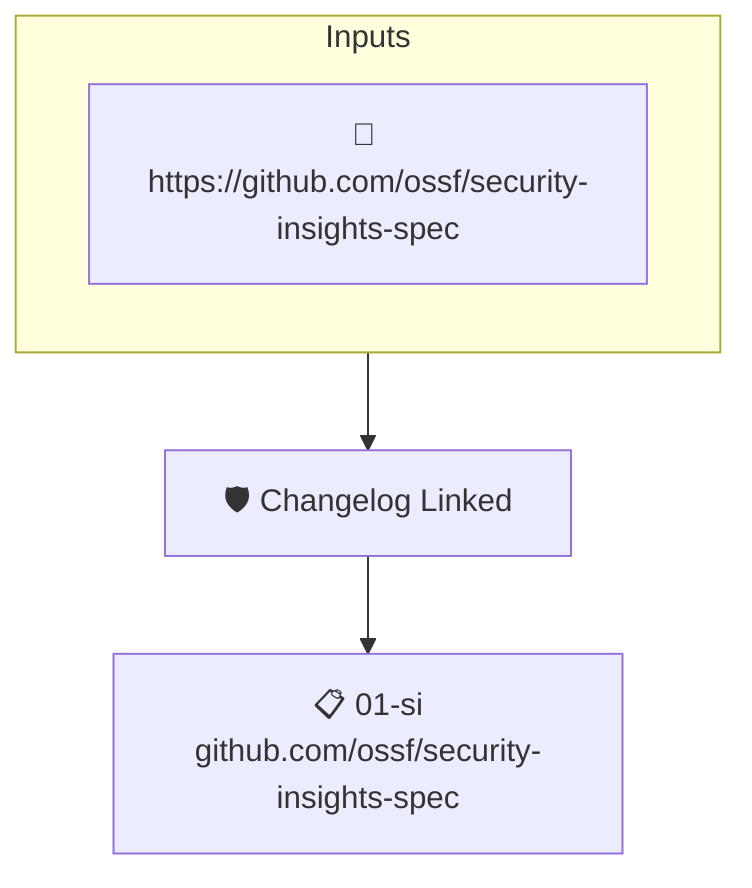

# Changelog Linked

Reads the project's attested [Security Insights](https://github.com/ossf/security-insights-spec) file. Fails when the release changelog field is not set.

## Overview

| Property | Value |
|----------|-------|
| **Type** | Policy |
| **ID** | `SI-CHANGELOG` |
| **Assert mode** | AND |
| **Tenets** | 1 |
| **Enforce** | ON |

## Structure



## Tenets

### Tenet: `01-si`

**Attestation types:**
- `https://github.com/ossf/security-insights-spec`

**Evaluation:**
```cel
outputs.changelog != '' 
```

**Outputs:**
- `changelog`: `has(predicates[0].data.repository) ? (has(predicates[0].data.repository.relea...`

**On pass:** Found a changelog entry in the project's security insights file.

**On fail:** Could not detect a changelog file in the security insights file.
**Guidance:** Add a changelog entry to your SI file under repository.release.changelog

