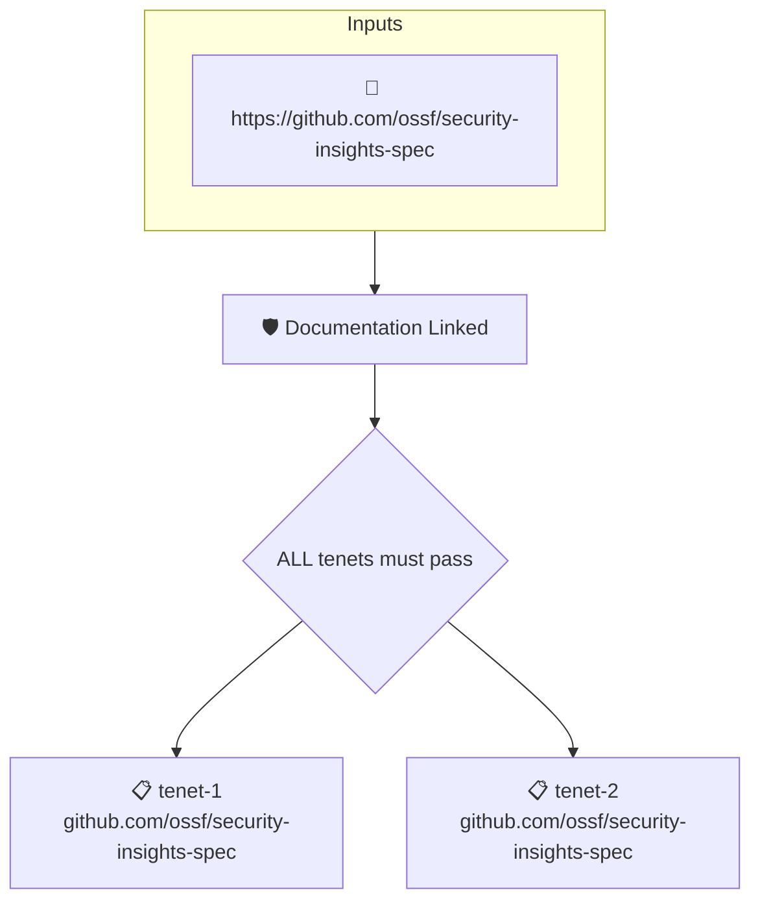

# Documentation Linked

Reads the project's attested [Security Insights](https://github.com/ossf/security-insights-spec) file. Fails when the detailed guide field is not set.

## Overview

| Property | Value |
|----------|-------|
| **Type** | Policy |
| **ID** | `SI-HAS-DOCUMENTATION` |
| **Assert mode** | AND |
| **Tenets** | 2 |
| **Enforce** | ON |

## Structure



## Tenets

### Tenet: `tenet-1`

**Attestation types:**
- `https://github.com/ossf/security-insights-spec`

**Evaluation:**
```cel
size(predicates) > 0
```

**On pass:** Security Insights attestation found

**On fail:** No Security Insights attestation found
**Guidance:** Capture your security insights flile in an attestations at build point

### Tenet: `tenet-2`

**Attestation types:**
- `https://github.com/ossf/security-insights-spec`

**Evaluation:**
```cel
outputs["docs"] != ""
```

**Outputs:**
- `docs`: `"documentation" in predicates[0].data.project ? ("detailed-guide" in predicat...`

**On pass:** Documentation link found in SECURITY_INSIGHTS.yaml

**On fail:** No documentation link found in SI
**Guidance:** Add a security insights file to your repository and define a documentation link

