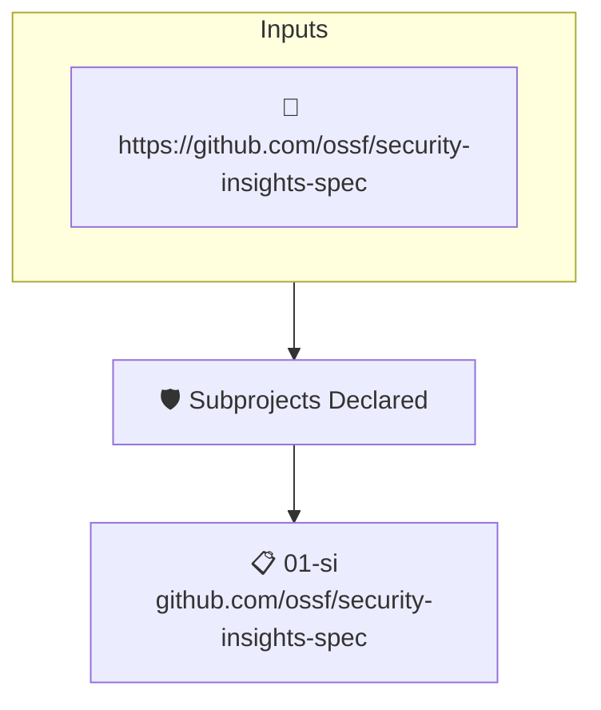

# Subprojects Declared

Reads the project's attested [Security Insights](https://github.com/ossf/security-insights-spec) file. Fails when the project does not declare its list of subproject repositories, which may be empty.

## Overview

| Property | Value |
|----------|-------|
| **Type** | Policy |
| **ID** | `SI-HAS-SUBPROJECTS` |
| **Assert mode** | AND |
| **Tenets** | 1 |
| **Enforce** | ON |

## Structure



## Tenets

### Tenet: `01-si`

**Attestation types:**
- `https://github.com/ossf/security-insights-spec`

**Evaluation:**
```cel
outputs.subprojects.found
```

**Outputs:**
- `subprojects`: `has(predicates[0].data.project) ? (has(predicates[0].data.project.repositorie...`

**On pass:** Found a changelog entry in the project's security insights file.

**On fail:** Could not find subprojects in security insights.
**Guidance:** Add a subprojects list (empty will do) to SI YAML under project.repositories

