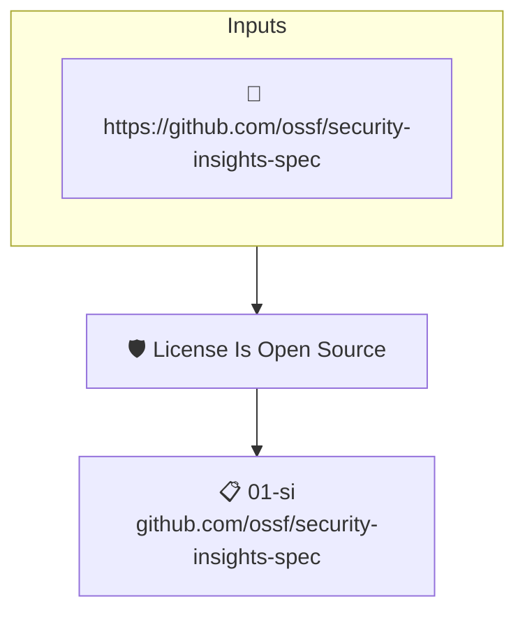

# License Is Open Source

Reads the project's attested [Security Insights](https://github.com/ossf/security-insights-spec) file. Fails when the declared license is not approved by the OSI or the FSF.

## Overview

| Property | Value |
|----------|-------|
| **Type** | Policy |
| **ID** | `SI-LICENSE-IS-OSS` |
| **Assert mode** | AND |
| **Tenets** | 1 |
| **Enforce** | ON |

## Structure



## Tenets

### Tenet: `01-si`

**Attestation types:**
- `https://github.com/ossf/security-insights-spec`

**Evaluation:**
```cel
outputs.license in outputs.license_list
```

**Outputs:**
- `license`: `has(predicates[0].data.repository) ? (has(predicates[0].data.repository.licen...`
- `license_list`: `['0BSD', 'AAL', 'AFL-1.1', 'AFL-1.2', 'AFL-2.0', 'AFL-2.1', 'AFL-3.0', 'AGPL-...`

**On pass:** Found a license entry in the project's security insights file.

**On fail:** Could not detect a license entry in the security insights file.
**Guidance:** Add a license entry to your SI file under repository.release.license

