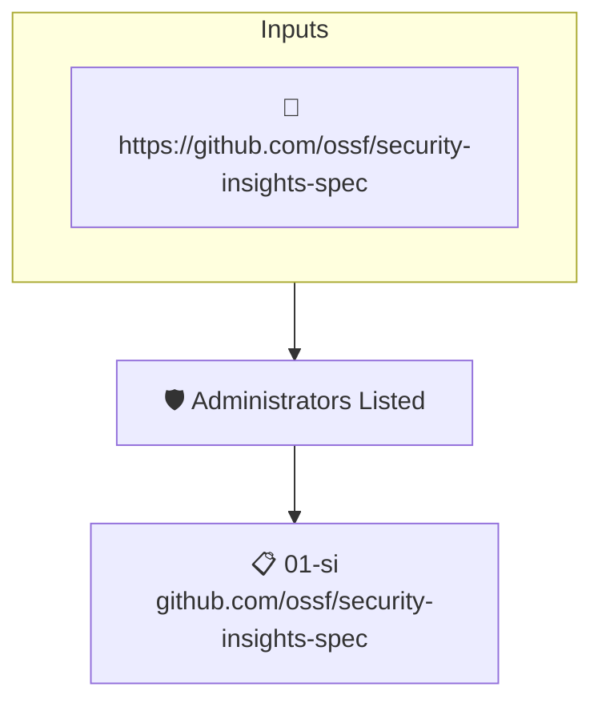

# Administrators Listed

Reads the project's attested [Security Insights](https://github.com/ossf/security-insights-spec) file. Fails when the project does not list its administrators.

## Overview

| Property | Value |
|----------|-------|
| **Type** | Policy |
| **ID** | `SI-ROLES` |
| **Assert mode** | AND |
| **Tenets** | 1 |
| **Enforce** | ON |

## Structure



## Tenets

### Tenet: `01-si`

**Attestation types:**
- `https://github.com/ossf/security-insights-spec`

**Evaluation:**
```cel
outputs.admins.found 
```

**Outputs:**
- `admins`: `has(predicates[0].data.project) ? (has(predicates[0].data.project.administrat...`

**On pass:** Administrators listed in Securty Insights

**On fail:** Security Insights has no project administrators
**Guidance:** List the project admins in your SI yaml under repository.administrators

