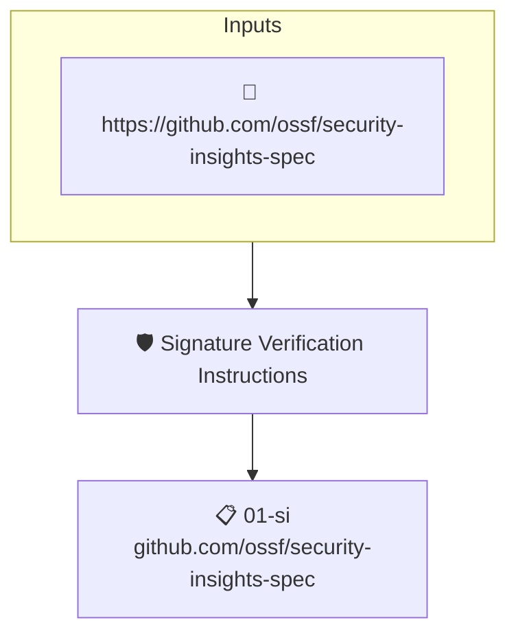

# Signature Verification Instructions

Reads the project's attested [Security Insights](https://github.com/ossf/security-insights-spec) file. Fails when it does not link to instructions for verifying the project's signatures.

## Overview

| Property | Value |
|----------|-------|
| **Type** | Policy |
| **ID** | `SI-SIGNATURE-VERIFY` |
| **Assert mode** | AND |
| **Tenets** | 1 |
| **Enforce** | ON |

## Structure



## Tenets

### Tenet: `01-si`

**Attestation types:**
- `https://github.com/ossf/security-insights-spec`

**Evaluation:**
```cel
outputs['verify'] != '' 
```

**Outputs:**
- `verify`: `has(predicates[0].data.project) ? (has(predicates[0].data.project.documentati...`

**On pass:** Signature verification instructions found in SECURITY_INSIGHTS.yml

**On fail:** No verification instructions found in SI
**Guidance:** Point to instructions to verify your signatures in SECURITY_INSIGHTS.aml

