# OpenSSF Security Baseline

Evaluates a project against the [Open Source Project Security Baseline](https://baseline.openssf.org), one policy group per control, each mapped to its OSPS control identifier. The groups read attestations about the repository, its releases and its SBOM.

## Overview

| Property | Value |
|----------|-------|
| **Type** | PolicySet |
| **ID** | `OSPS` |
| **Enforce** | ON |
| **Policies** | 0 |
| **Groups** | 36 |

## Structure

```mermaid
flowchart TD
    S["📦 OSPS"]
    S --> G0["📂 OSPS-AC-01"]
    G0 --> G0_B0["⚡ Block 1"]
    G0_B0 --> G0_B0_P0["🛡️ SLSA-SRC-GHORG"]
    S --> G1["📂 OSPS-AC-02"]
    G1 --> G1_B0["⚡ Block 1"]
    G1_B0 --> G1_B0_P0["🛡️ SNAPPY-ORG-EXISTS"]
    S --> G2["📂 OSPS-AC-03"]
    G2 --> G2_B0["⚡ Block 1"]
    G2_B0 --> G2_B0_P0["🛡️ SNAPPY-BRANCH-PROTECTION"]
    S --> G3["📂 OSPS-AC-04"]
    G3 --> G3_B0["⚡ Block 1"]
    G3_B0 --> G3_B0_P0["🛡️ SCORECARD-TOKEN-PERMISSIONS"]
    S --> G4["📂 OSPS-BR-01"]
    G4 --> G4_B0["⚡ Block 1"]
    G4_B0 --> G4_B0_P0["🛡️ SCORECARD-DANGEROURS-WF"]
    S --> G5["📂 OSPS-BR-02"]
    G5 --> G5_B0["⚡ Block 1"]
    G5_B0 --> G5_B0_P0["🛡️ sbom-has-versions"]
    S --> G6["📂 OSPS-BR-04"]
    G6 --> G6_B0["⚡ Block 1"]
    G6_B0 --> G6_B0_P0["🛡️ sbom-contains-changelog"]
    S --> G7["📂 OSPS-BR-05"]
    G7 --> G7_B0["⚡ Block 1"]
    G7_B0 --> G7_B0_P0["🛡️ sbom-contains-lockfile"]
    S --> G8["📂 OSPS-BR-06"]
    G8 --> G8_B0["⚡ Block 1"]
    G8_B0 --> G8_B0_P0["🛡️ slsa-has-attestation"]
    S --> G9["📂 OSPS-DO-01"]
    G9 --> G9_B0["⚡ Block 1"]
    G9_B0 --> G9_B0_P0["🛡️ SI-HAS-DOCUMENTATION"]
    S --> G10["📂 OSPS-DO-02"]
    G10 --> G10_B0["⚡ Block 1"]
    G10_B0 --> G10_B0_P0["🛡️ SI-VULN-REPORTING"]
    S --> G11["📂 OSPS-DO-03"]
    G11 --> G11_B0["⚡ Block 1"]
    G11_B0 --> G11_B0_P0["🛡️ SI-SIGNATURE-VERIFY"]
    S --> G12["📂 OSPS-DO-04"]
    G12 --> G12_B0["⚡ Block 1"]
    G12_B0 --> G12_B0_P0["🛡️ OPENEOX-EXISTS"]
    S --> G13["📂 OSPS-DO-05"]
    G13 --> G13_B0["⚡ Block 1"]
    G13_B0 --> G13_B0_P0["🛡️ OPENEOX-EXISTS"]
    S --> G14["📂 OSPS-DO-06"]
    G14 --> G14_B0["⚡ Block 1"]
    G14_B0 --> G14_B0_P0["🛡️ SI-DEPENDENCY-POLICY"]
    S --> G15["📂 OSPS-GV-01"]
    G15 --> G15_B0["⚡ Block 1"]
    G15_B0 --> G15_B0_P0["🛡️ SI-ROLES"]
    S --> G16["📂 OSPS-GV-02"]
    G16 --> G16_B0["⚡ Block 1"]
    G16_B0 --> G16_B0_P0["🛡️ SNAPPY-REPO-HAS-ISSUES"]
    S --> G17["📂 OSPS-GV-03"]
    G17 --> G17_B0["⚡ Block 1"]
    G17_B0 --> G17_B0_P0["🛡️ sbom-contains-contributing-md"]
    S --> G18["📂 OSPS-GV-04"]
    G18 --> G18_B0["⚡ Block 1"]
    G18_B0 --> G18_B0_P0["🛡️ (inline policy)"]
    S --> G19["📂 OSPS-LE-02"]
    G19 --> G19_B0["⚡ Block 1"]
    G19_B0 --> G19_B0_P0["🛡️ sbom-licenses-are-foss"]
    S --> G20["📂 OSPS-LE-03"]
    G20 --> G20_B0["⚡ Block 1"]
    G20_B0 --> G20_B0_P0["🛡️ sbom-contains-license-file"]
    S --> G21["📂 OSPS-QA-01"]
    G21 --> G21_B0["⚡ Block 1"]
    G21_B0 --> G21_B0_P0["🛡️ SNAPPY-REPO-PUBLIC-GIT"]
    S --> G22["📂 OSPS-QA-02"]
    G22 --> G22_B0["⚡ Block 1"]
    G22_B0 --> G22_B0_P0["🛡️ sbom-exists"]
    S --> G23["📂 OSPS-QA-03"]
    G23 --> G23_B0["⚡ Block 1"]
    G23_B0 --> G23_B0_P0["🛡️ SNAPPY-BRANCH-STATUS-CHECKS"]
    S --> G24["📂 OSPS-QA-04"]
    G24 --> G24_B0["⚡ Block 1"]
    G24_B0 --> G24_B0_P0["🛡️ SI-HAS-SUBPROJECTS"]
    S --> G25["📂 OSPS-QA-05"]
    G25 --> G25_B0["⚡ Block 1"]
    G25_B0 --> G25_B0_P0["🛡️ SCORECARD-BINARY-ARTIFACTS"]
    S --> G26["📂 OSPS-QA-06"]
    G26 --> G26_B0["⚡ Block 1"]
    G26_B0 --> G26_B0_P0["🛡️ test-results-pass"]
    S --> G27["📂 OSPS-QA-07"]
    G27 --> G27_B0["⚡ Block 1"]
    G27_B0 --> G27_B0_P0["🛡️ SCORECARD-CODE-REVIEW"]
    S --> G28["📂 OSPS-SA-01"]
    G28 --> G28_B0["⚡ Block 1"]
    G28_B0 --> G28_B0_P0["🛡️ (inline policy)"]
    S --> G29["📂 OSPS-SA-02"]
    G29 --> G29_B0["⚡ Block 1"]
    G29_B0 --> G29_B0_P0["🛡️ (inline policy)"]
    S --> G30["📂 OSPS-SA-03"]
    G30 --> G30_B0["⚡ Block 1"]
    G30_B0 --> G30_B0_P0["🛡️ SI-ASSESSMENTS"]
    S --> G31["📂 OSPS-VM-01"]
    G31 --> G31_B0["⚡ Block 1"]
    G31_B0 --> G31_B0_P0["🛡️ sbom-contains-security-md"]
    S --> G32["📂 OSPS-VM-02"]
    G32 --> G32_B0["⚡ Block 1"]
    G32_B0 --> G32_B0_P0["🛡️ SI-VULN-REP-CONTACT"]
    S --> G33["📂 OSPS-VM-04"]
    G33 --> G33_M{"ANY block passing suffices"}
    G33_M --> G33_B0["⚡ Block 1"]
    G33_B0 --> G33_B0_P0["🛡️ OPENVEX-VULNS-ARE-VEXED"]
    G33_M --> G33_B1["⚡ Block 2"]
    G33_B1 --> G33_B1_P0["🛡️ grype-no-vulns"]
    G33_M --> G33_B2["⚡ Block 3"]
    G33_B2 --> G33_B2_P0["🛡️ trivy-no-vulns"]
    S --> G34["📂 OSPS-VM-05"]
    G34 --> G34_B0["⚡ Block 1"]
    G34_B0 --> G34_B0_P0["🛡️ openvex-no-exploitable-vulns"]
    S --> G35["📂 OSPS-VM-06"]
    G35 --> G35_B0["⚡ Block 1"]
    G35_B0 --> G35_B0_P0["🛡️ SCORECARD-SAST"]
```

## PolicyGroup: `OSPS-AC-01`

### Overview

| Property | Value |
|----------|-------|
| **Type** | PolicyGroup |
| **ID** | `OSPS-AC-01` |
| **Blocks** | 1 |
| **Enforce** | ON |

### Structure

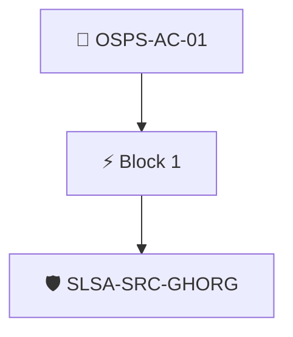

### Block: `block-1` (assert: AND)

#### Policy: `SLSA-SRC-GHORG`

Evaluates if athe repository is hosted in GitHub

##### Overview

| Property | Value |
|----------|-------|
| **Type** | Policy |
| **ID** | `SLSA-SRC-GHORG` |
| **Assert mode** | AND |
| **Tenets** | 1 |
| **Enforce** | ON |

##### Tenets

###### Tenet: `01`

**Attestation types:**
- `https://github.com/slsa-framework/slsa-source-poc/source-provenance/v1-draft`

**Evaluation:**
```cel
outputs.org.name.indexOf('github.com') == 0 
```

**Outputs:**
- `org`: `github.orgDescriptorFromURI(predicate.data.repoUri)`

**On pass:** GitHub organization found in SLSA provenance


## PolicyGroup: `OSPS-AC-02`

### Overview

| Property | Value |
|----------|-------|
| **Type** | PolicyGroup |
| **ID** | `OSPS-AC-02` |
| **Blocks** | 1 |
| **Enforce** | ON |

### Structure

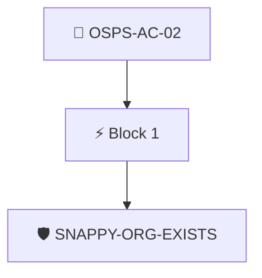

### Block: `block-1` (assert: AND)

#### Policy: `SNAPPY-ORG-EXISTS`

Attested GitHub organization data available

##### Overview

| Property | Value |
|----------|-------|
| **Type** | Policy |
| **ID** | `SNAPPY-ORG-EXISTS` |
| **Assert mode** | AND |
| **Tenets** | 1 |
| **Enforce** | ON |

##### Tenets

###### Tenet: `01`

**Attestation types:**
- `http://github.com/carabiner-dev/snappy/specs/github/org.yaml`
- `http://github.com/carabiner-dev/snappy/specs/org.yaml`

**Evaluation:**
```cel
true
```

**On pass:** Attested GitHub organization data found


## PolicyGroup: `OSPS-AC-03`

### Overview

| Property | Value |
|----------|-------|
| **Type** | PolicyGroup |
| **ID** | `OSPS-AC-03` |
| **Blocks** | 1 |
| **Enforce** | ON |

### Structure

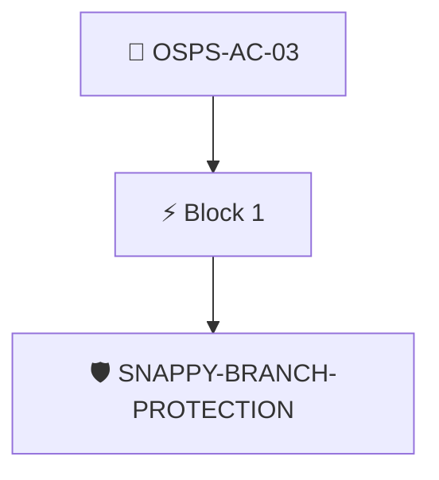

### Block: `block-1` (assert: AND)

#### Policy: `SNAPPY-BRANCH-PROTECTION`

VCS MUST prevent unintentional modification of the primary branch.

##### Overview

| Property | Value |
|----------|-------|
| **Type** | Policy |
| **ID** | `SNAPPY-BRANCH-PROTECTION` |
| **Assert mode** | AND |
| **Tenets** | 3 |
| **Enforce** | ON |

##### Tenets

###### Tenet: `tenet-1`

**Attestation types:**
- `http://github.com/carabiner-dev/snappy/specs/github/branch-rules.yaml`
- `http://github.com/carabiner-dev/snappy/specs/branch-rules.yaml`

**Evaluation:**
```cel
size(predicates) > 0
```

**On pass:** Found attested branch protection metadata

###### Tenet: `01`

**Attestation types:**
- `http://github.com/carabiner-dev/snappy/specs/github/branch-rules.yaml`
- `http://github.com/carabiner-dev/snappy/specs/branch-rules.yaml`

**Evaluation:**
```cel
has(predicates[0].data.values) ? predicates[0].data.values.exists(rule, rule.type == "non_fast_forward") : false
```

**On pass:** Force pushing is disabled on default branch

**On fail:** Force pushes can be sent to main branch
**Guidance:** Create a branch ruleset protecting your default branch and enable "Block force pushes"

###### Tenet: `02`

**Attestation types:**
- `http://github.com/carabiner-dev/snappy/specs/github/branch-rules.yaml`
- `http://github.com/carabiner-dev/snappy/specs/branch-rules.yaml`

**Evaluation:**
```cel
has(predicates[0].data.values) ? predicates[0].data.values.exists(rule, rule.type == "deletion") : false
```

**On pass:** Branch deletion is disabled on default branch

**On fail:** Branch delete protection is not enabled
**Guidance:** Create a branch ruleset protecting your default branch and enable "Restrict deletions"


## PolicyGroup: `OSPS-AC-04`

### Overview

| Property | Value |
|----------|-------|
| **Type** | PolicyGroup |
| **ID** | `OSPS-AC-04` |
| **Blocks** | 1 |
| **Enforce** | ON |

### Structure

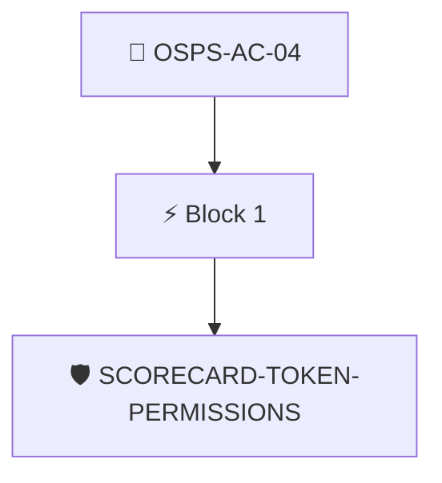

### Block: `block-1` (assert: AND)

#### Policy: `SCORECARD-TOKEN-PERMISSIONS`

CI/CD pipelines MUST follow the principle of least privilege

##### Overview

| Property | Value |
|----------|-------|
| **Type** | Policy |
| **ID** | `SCORECARD-TOKEN-PERMISSIONS` |
| **Assert mode** | AND |
| **Tenets** | 1 |
| **Enforce** | OFF |

##### Tenets

###### Tenet: `01-scorecard`

**Attestation types:**
- `https://scorecard.dev/result/v0.1`

**Evaluation:**
```cel
outputs.perms.all(c, c.score == 10)
```

**Outputs:**
- `perms`: `has(predicates[0].data.checks) ? predicates[0].data.checks.filter(c, c.name =...`

**On pass:** Scorecard reports workflows are configured with least privileges

**On fail:** Scorecard detected workflows with excessivce permissions
**Guidance:** Ensure workflows drop all privileges and only escalte when needed


## PolicyGroup: `OSPS-BR-01`

The project's build and release pipelines MUST NOT permit untrusted input

### Overview

| Property | Value |
|----------|-------|
| **Type** | PolicyGroup |
| **ID** | `OSPS-BR-01` |
| **Blocks** | 1 |
| **Enforce** | ON |

### Structure

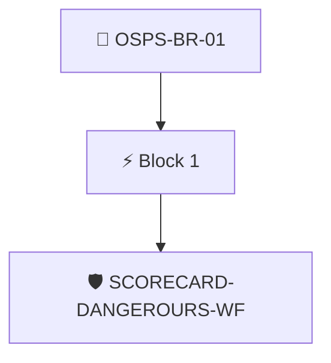

### Block: `block-1` (assert: AND)

#### Policy: `SCORECARD-DANGEROURS-WF`

The project's build and release pipelines MUST NOT permit untrusted input

##### Overview

| Property | Value |
|----------|-------|
| **Type** | Policy |
| **ID** | `SCORECARD-DANGEROURS-WF` |
| **Assert mode** | AND |
| **Tenets** | 1 |
| **Enforce** | ON |

##### Tenets

###### Tenet: `01-scorecard`

**Attestation types:**
- `https://scorecard.dev/result/v0.1`

**Evaluation:**
```cel
outputs.bin_artifacts_checks.all(c, c.score == 10)
```

**Outputs:**
- `bin_artifacts_checks`: `has(predicates[0].data.checks) ? predicates[0].data.checks.filter(c, c.name =...`

**On pass:** Scorecard found no dangerous pipelines

**On fail:** Scorecard detected workflows with dangerous patterns
**Guidance:** Review your workflow files and look for dangerous patterns


## PolicyGroup: `OSPS-BR-02`

Releases and released software assets MUST be assigned a unique version identifier

### Overview

| Property | Value |
|----------|-------|
| **Type** | PolicyGroup |
| **ID** | `OSPS-BR-02` |
| **Blocks** | 1 |
| **Enforce** | ON |

### Structure

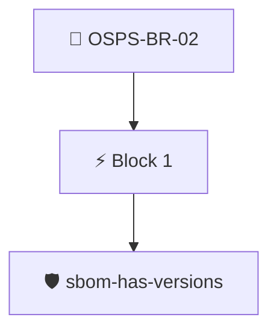

### Block: `block-1` (assert: AND)

#### Policy: `sbom-has-versions`

Checks an SBOMs top level components to ensure versions are set

##### Overview

| Property | Value |
|----------|-------|
| **Type** | Policy |
| **ID** | `sbom-has-versions` |
| **Assert mode** | AND |
| **Tenets** | 1 |
| **Enforce** | ON |

##### Tenets

###### Tenet: `01-sbom`

**Attestation types:**
- `https://spdx.dev/Document`
- `https://cyclonedx.org/bom`

**Evaluation:**
```cel
outputs.versions.all(s, s != "")
```

**Outputs:**
- `versions`: `sboms[0].get_node_list().get_root_nodes().map(s, s.version)`

**On pass:** All top level components have versions

**On fail:** Som of the top level components in the SBOM are missing versions.
**Guidance:** Ensure the SBOM generation tool is capturing the release version.


## PolicyGroup: `OSPS-BR-04`

When an official release is created, that release MUST contain a descriptive log of functional and security modifications

### Overview

| Property | Value |
|----------|-------|
| **Type** | PolicyGroup |
| **ID** | `OSPS-BR-04` |
| **Blocks** | 1 |
| **Enforce** | ON |

### Structure

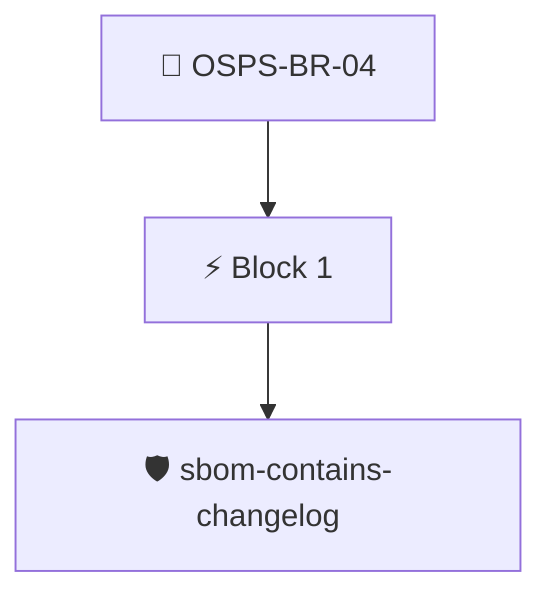

### Block: `block-1` (assert: AND)

#### Policy: `sbom-contains-changelog`

Checks an SBOM to locate a Changelog in the file lists

##### Overview

| Property | Value |
|----------|-------|
| **Type** | Policy |
| **ID** | `sbom-contains-changelog` |
| **Assert mode** | AND |
| **Tenets** | 1 |
| **Enforce** | ON |

##### Tenets

###### Tenet: `01-sbom`

**Attestation types:**
- `https://spdx.dev/Document`
- `https://cyclonedx.org/bom`

**Evaluation:**
```cel
size(outputs["files"]) > 0
```

**Outputs:**
- `files`: `sboms[0].get_node_list().get_nodes().filter(n, (n.name == 'CHANGELOG' || n.na...`

**On pass:** Found a changelog in the project's SBOM.

**On fail:** Could not detect a changelog file in the SBOM.
**Guidance:** Add a file named CHANGELOG to your project's codebase registering major changes.


## PolicyGroup: `OSPS-BR-05`

All build and release pipelines MUST use standardized tooling where available to ingest dependencies at build time

### Overview

| Property | Value |
|----------|-------|
| **Type** | PolicyGroup |
| **ID** | `OSPS-BR-05` |
| **Blocks** | 1 |
| **Enforce** | ON |

### Structure

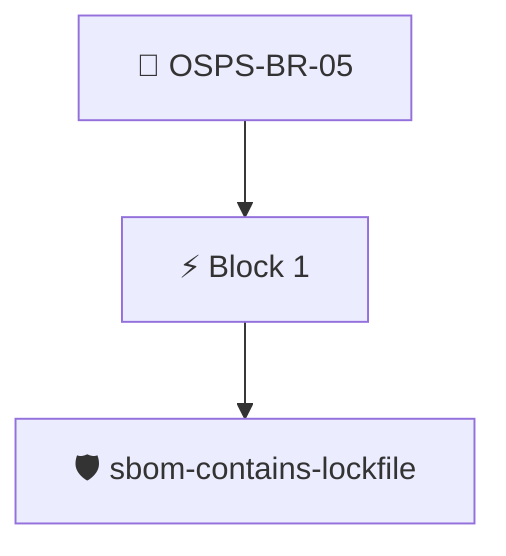

### Block: `block-1` (assert: AND)

#### Policy: `sbom-contains-lockfile`

Checks for a language dependency lockfile among the SBOM files

##### Overview

| Property | Value |
|----------|-------|
| **Type** | Policy |
| **ID** | `sbom-contains-lockfile` |
| **Assert mode** | AND |
| **Tenets** | 1 |
| **Enforce** | ON |

##### Tenets

###### Tenet: `01-lockfile`

**Attestation types:**
- `https://spdx.dev/Document`
- `https://cyclonedx.org/bom`

**Evaluation:**
```cel
size(outputs["files"]) > 0
```

**Outputs:**
- `files`: `sboms[0].get_node_list().get_nodes().filter(n, (n.name == 'requirements.txt' ...`

**On pass:** Found a package lock file

**On fail:** Could not detect a package lock file
**Guidance:** Ensure your project uses go, pypy, npm or ruby gems tooling o handle dependencies


## PolicyGroup: `OSPS-BR-06`

Release MUST be signed or accounted for in a signed manifest

### Overview

| Property | Value |
|----------|-------|
| **Type** | PolicyGroup |
| **ID** | `OSPS-BR-06` |
| **Blocks** | 1 |
| **Enforce** | OFF |

### Structure

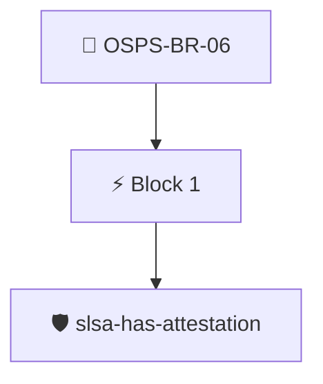

### Block: `block-1` (assert: AND)

#### Policy: `slsa-has-attestation`

Checks if a SLSA provenance attestation is available

##### Overview

| Property | Value |
|----------|-------|
| **Type** | Policy |
| **ID** | `slsa-has-attestation` |
| **Assert mode** | AND |
| **Tenets** | 1 |
| **Enforce** | ON |

##### Tenets

###### Tenet: `slsa`

**Attestation types:**
- `https://slsa.dev/provenance/v0.2`
- `https://slsa.dev/provenance/v1`

**Evaluation:**
```cel
size(predicates) > 0
```

**On pass:** SLSA provenance attestation found

**On fail:** No SLSA attestation found
**Guidance:** Capture the build process in a SLSA provenance attestation


## PolicyGroup: `OSPS-DO-01`

The project documentation MUST provide user guides for all basic functionality

### Overview

| Property | Value |
|----------|-------|
| **Type** | PolicyGroup |
| **ID** | `OSPS-DO-01` |
| **Blocks** | 1 |
| **Enforce** | ON |

### Structure

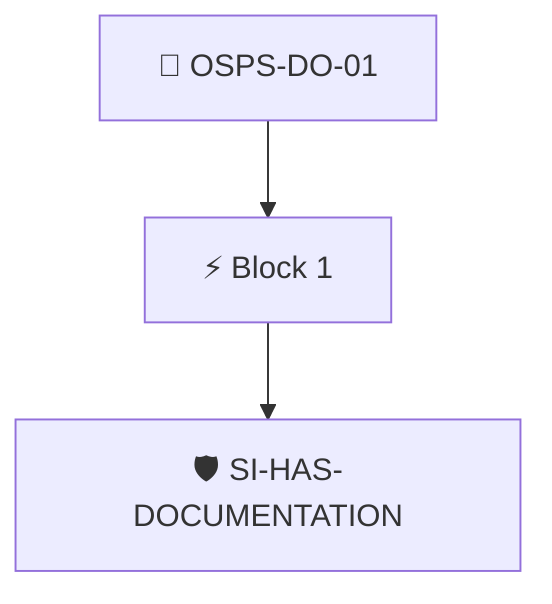

### Block: `block-1` (assert: AND)

#### Policy: `SI-HAS-DOCUMENTATION`

Ensure the detailed-guide field in SI is populated

##### Overview

| Property | Value |
|----------|-------|
| **Type** | Policy |
| **ID** | `SI-HAS-DOCUMENTATION` |
| **Assert mode** | AND |
| **Tenets** | 2 |
| **Enforce** | ON |

##### Tenets

###### Tenet: `tenet-1`

**Attestation types:**
- `https://github.com/ossf/security-insights-spec`

**Evaluation:**
```cel
size(predicates) > 0
```

**On pass:** Security Insights attestation found

**On fail:** No Security Insights attestation found
**Guidance:** Capture your security insights flile in an attestations at build point

###### Tenet: `tenet-2`

**Attestation types:**
- `https://github.com/ossf/security-insights-spec`

**Evaluation:**
```cel
outputs["docs"] != ""
```

**Outputs:**
- `docs`: `"documentation" in predicates[0].data.project ? ("detailed-guide" in predicat...`

**On pass:** Documentation link found in SECURITY_INSIGHTS.yaml

**On fail:** No documentation link found in SI
**Guidance:** Add a security insights file to your repository and define a documentation link


## PolicyGroup: `OSPS-DO-02`

The project MUST provide a mechanism for reporting defects

### Overview

| Property | Value |
|----------|-------|
| **Type** | PolicyGroup |
| **ID** | `OSPS-DO-02` |
| **Blocks** | 1 |
| **Enforce** | ON |

### Structure

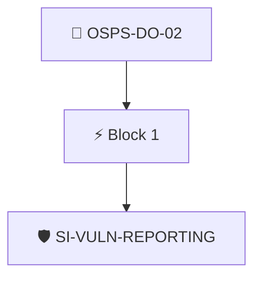

### Block: `block-1` (assert: AND)

#### Policy: `SI-VULN-REPORTING`

Checks SI data for a vulnerability reporting link and ensures reports are accepted

##### Overview

| Property | Value |
|----------|-------|
| **Type** | Policy |
| **ID** | `SI-VULN-REPORTING` |
| **Assert mode** | AND |
| **Tenets** | 2 |
| **Enforce** | ON |

##### Tenets

###### Tenet: `tenet-1`

**Attestation types:**
- `https://github.com/ossf/security-insights-spec`

**Evaluation:**
```cel
outputs["reporting"]  
```

**Outputs:**
- `reporting`: `"vulnerability-reporting" in predicates[0].data.project ? ("reports-accepted"...`

**On pass:** Project accepts vulnerability reports according to SECURITY_INSIGHTS.yml

**On fail:** No vulnerability reports found in SI
**Guidance:** Add a security insights file to your repository and define reports-accepted as true under vulnerability-reporting

###### Tenet: `tenet-2`

**Attestation types:**
- `https://github.com/ossf/security-insights-spec`

**Evaluation:**
```cel
outputs["vulnerability-report-contact"]  
```

**Outputs:**
- `vulnerability-report-contact`: `"vulnerability-reporting" in predicates[0].data.project ? ("contact" in predi...`

**On pass:** Vulnerability report contact found

**On fail:** No contact information found in SECURITY_INSIGHTS.yml
**Guidance:** Add contact data in the project's SECURITY_INSIGHTS.yml file, under vulnerability-reporting


## PolicyGroup: `OSPS-DO-03`

Instructions to verify the integrity and authenticity of the release assets

### Overview

| Property | Value |
|----------|-------|
| **Type** | PolicyGroup |
| **ID** | `OSPS-DO-03` |
| **Blocks** | 1 |
| **Enforce** | ON |

### Structure

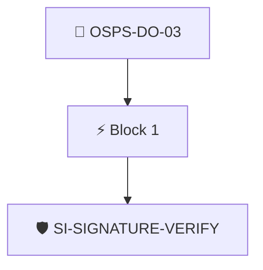

### Block: `block-1` (assert: AND)

#### Policy: `SI-SIGNATURE-VERIFY`

Ensures the security insights file links a signature verification document

##### Overview

| Property | Value |
|----------|-------|
| **Type** | Policy |
| **ID** | `SI-SIGNATURE-VERIFY` |
| **Assert mode** | AND |
| **Tenets** | 1 |
| **Enforce** | ON |

##### Tenets

###### Tenet: `01-si`

**Attestation types:**
- `https://github.com/ossf/security-insights-spec`

**Evaluation:**
```cel
outputs['verify'] != '' 
```

**Outputs:**
- `verify`: `has(predicates[0].data.project) ? (has(predicates[0].data.project.documentati...`

**On pass:** Signature verification instructions found in SECURITY_INSIGHTS.yml

**On fail:** No verification instructions found in SI
**Guidance:** Point to instructions to verify your signatures in SECURITY_INSIGHTS.aml


## PolicyGroup: `OSPS-DO-04`

the project documentation MUST include a descriptive statement about the scope and duration of support

### Overview

| Property | Value |
|----------|-------|
| **Type** | PolicyGroup |
| **ID** | `OSPS-DO-04` |
| **Blocks** | 1 |
| **Enforce** | ON |

### Structure


### Block: `block-1` (assert: AND)

#### Policy: `OPENEOX-EXISTS`

Ensures there is an openeox attestation

##### Overview

| Property | Value |
|----------|-------|
| **Type** | Policy |
| **ID** | `OPENEOX-EXISTS` |
| **Assert mode** | AND |
| **Tenets** | 1 |
| **Enforce** | ON |

##### Tenets

###### Tenet: `01-openeox`

**Attestation types:**
- `https://docs.oasis-open.org/openeox/core/v1.0`
- `https://docs.oasis-open.org/openeox/eox-core/v1.0`

**Evaluation:**
```cel
size(predicates) > 0
```

**On pass:** Found an OpenEoX statement with the artifact's EOS.

**On fail:** No OpenEOX data found.
**Guidance:** Capture the project End of Support in an OpenEOX file.


## PolicyGroup: `OSPS-DO-05`

The project documentation MUST provide a descriptive statement when releases or versions will no longer receive security updates

### Overview

| Property | Value |
|----------|-------|
| **Type** | PolicyGroup |
| **ID** | `OSPS-DO-05` |
| **Blocks** | 1 |
| **Enforce** | ON |

### Structure

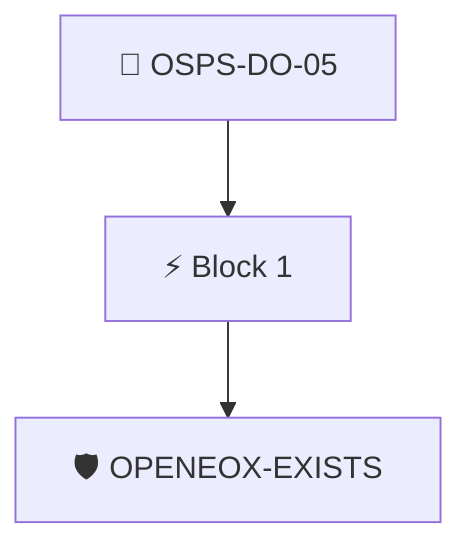

### Block: `block-1` (assert: AND)

#### Policy: `OPENEOX-EXISTS`

Ensures there is an openeox attestation

##### Overview

| Property | Value |
|----------|-------|
| **Type** | Policy |
| **ID** | `OPENEOX-EXISTS` |
| **Assert mode** | AND |
| **Tenets** | 1 |
| **Enforce** | ON |

##### Tenets

###### Tenet: `01-openeox`

**Attestation types:**
- `https://docs.oasis-open.org/openeox/core/v1.0`
- `https://docs.oasis-open.org/openeox/eox-core/v1.0`

**Evaluation:**
```cel
size(predicates) > 0
```

**On pass:** Found an OpenEoX statement with the artifact's EOS.

**On fail:** No OpenEOX data found.
**Guidance:** Capture the project End of Support in an OpenEOX file.


## PolicyGroup: `OSPS-DO-06`

The project's documentation MUST include a description of how the project selects, obtains, and tracks its dependencies.

### Overview

| Property | Value |
|----------|-------|
| **Type** | PolicyGroup |
| **ID** | `OSPS-DO-06` |
| **Blocks** | 1 |
| **Enforce** | ON |

### Structure

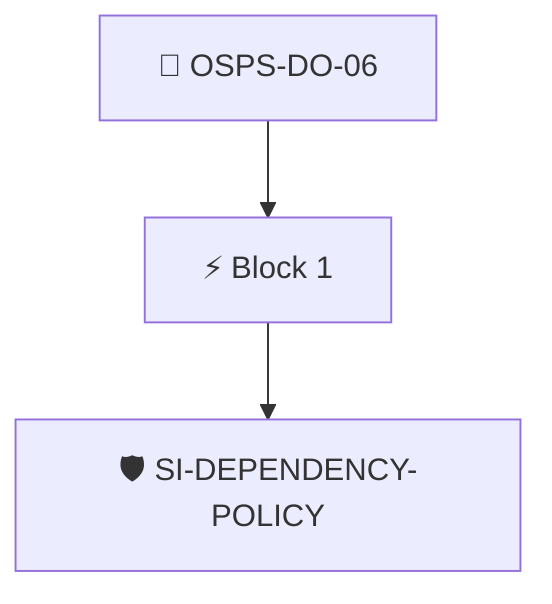

### Block: `block-1` (assert: AND)

#### Policy: `SI-DEPENDENCY-POLICY`

Checks security insights to ensure it links to a dependency policy

##### Overview

| Property | Value |
|----------|-------|
| **Type** | Policy |
| **ID** | `SI-DEPENDENCY-POLICY` |
| **Assert mode** | AND |
| **Tenets** | 1 |
| **Enforce** | ON |

##### Tenets

###### Tenet: `01-si`

**Attestation types:**
- `https://github.com/ossf/security-insights-spec`

**Evaluation:**
```cel
outputs.deppolicy != '' 
```

**Outputs:**
- `deppolicy`: `has(predicates[0].data.repository) ? (has(predicates[0].data.repository.docum...`

**On pass:** Found a link to the projects dependency policy in SECURITY_INSIGHTS.yml

**On fail:** Could not detect a dependency policy in the Security Insights file.
**Guidance:** Add a changelog entry to your SI file under repository.documentation.dependency-management-policy.


## PolicyGroup: `OSPS-GV-01`

### Overview

| Property | Value |
|----------|-------|
| **Type** | PolicyGroup |
| **ID** | `OSPS-GV-01` |
| **Blocks** | 1 |
| **Enforce** | ON |

### Structure

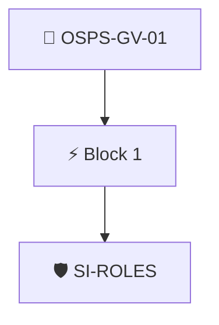

### Block: `block-1` (assert: AND)

#### Policy: `SI-ROLES`

Check the security insights file to ensure administrators are set

##### Overview

| Property | Value |
|----------|-------|
| **Type** | Policy |
| **ID** | `SI-ROLES` |
| **Assert mode** | AND |
| **Tenets** | 1 |
| **Enforce** | ON |

##### Tenets

###### Tenet: `01-si`

**Attestation types:**
- `https://github.com/ossf/security-insights-spec`

**Evaluation:**
```cel
outputs.admins.found 
```

**Outputs:**
- `admins`: `has(predicates[0].data.project) ? (has(predicates[0].data.project.administrat...`

**On pass:** Administrators listed in Securty Insights

**On fail:** Security Insights has no project administrators
**Guidance:** List the project admins in your SI yaml under repository.administrators


## PolicyGroup: `OSPS-GV-02`

The project MUST have one or more mechanisms for public discussions about proposed changes and usage obstacles.

### Overview

| Property | Value |
|----------|-------|
| **Type** | PolicyGroup |
| **ID** | `OSPS-GV-02` |
| **Blocks** | 1 |
| **Enforce** | ON |

### Structure

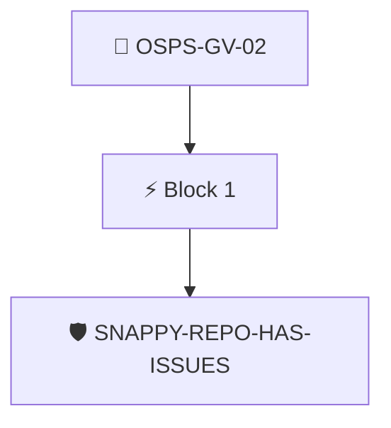

### Block: `block-1` (assert: AND)

#### Policy: `SNAPPY-REPO-HAS-ISSUES`

Checks if a repository has issues enabled

##### Overview

| Property | Value |
|----------|-------|
| **Type** | Policy |
| **ID** | `SNAPPY-REPO-HAS-ISSUES` |
| **Assert mode** | AND |
| **Tenets** | 2 |
| **Enforce** | ON |

##### Tenets

###### Tenet: `tenet-1`

**Attestation types:**
- `http://github.com/carabiner-dev/snappy/specs/github/repo.yaml`
- `http://github.com/carabiner-dev/snappy/specs/repo.yaml`

**Evaluation:**
```cel
size(predicates) > 0
```

**On pass:** Found attested repository data

###### Tenet: `01`

**Attestation types:**
- `http://github.com/carabiner-dev/snappy/specs/github/repo.yaml`
- `http://github.com/carabiner-dev/snappy/specs/repo.yaml`

**Evaluation:**
```cel
outputs["issues"]
```

**Outputs:**
- `issues`: `has(predicates[0].data.values.has_issues) ? predicates[0].data.values.has_iss...`

**On pass:** Issues feature is enabled in the repository

**On fail:** Issues are not enabled in the repo
**Guidance:** Turn on the issues setting in the repository


## PolicyGroup: `OSPS-GV-03`

The project documentation MUST include an explanation of the contribution process.

### Overview

| Property | Value |
|----------|-------|
| **Type** | PolicyGroup |
| **ID** | `OSPS-GV-03` |
| **Blocks** | 1 |
| **Enforce** | ON |

### Structure

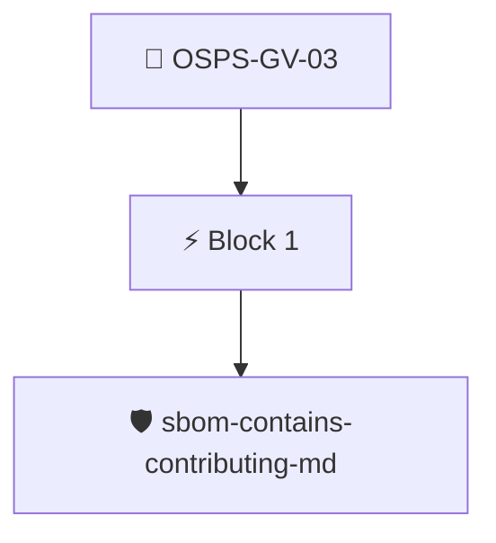

### Block: `block-1` (assert: AND)

#### Policy: `sbom-contains-contributing-md`

Checks for a CONTRIBUTING.md file in the SBOM

##### Overview

| Property | Value |
|----------|-------|
| **Type** | Policy |
| **ID** | `sbom-contains-contributing-md` |
| **Assert mode** | AND |
| **Tenets** | 1 |
| **Enforce** | ON |

##### Tenets

###### Tenet: `01`

**Attestation types:**
- `https://spdx.dev/Document`
- `https://cyclonedx.org/bom`

**Evaluation:**
```cel
size(outputs['files']) > 0
```

**Outputs:**
- `files`: `sboms[0].get_node_list().get_nodes().filter(n, n.name == "CONTRIBUTING.md")`

**On pass:** Found a CONTRIBUTING.md file

**On fail:** Repository has no CONTRIBUTING.md file
**Guidance:** Write up the project's contribution process into a CONTRIBUTING.md file and check it into the repository.


## PolicyGroup: `OSPS-GV-04`

Policy that code contributors are reviewed prior to granting escalated permissions

### Overview

| Property | Value |
|----------|-------|
| **Type** | PolicyGroup |
| **ID** | `OSPS-GV-04` |
| **Blocks** | 1 |
| **Enforce** | OFF |

### Structure

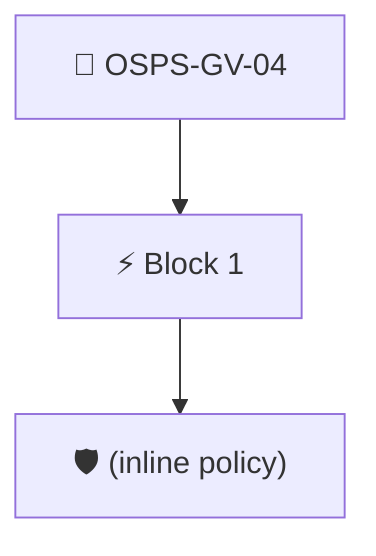

### Block: `block-1` (assert: AND)

#### Policy: `(inline policy)`

##### Overview

| Property | Value |
|----------|-------|
| **Type** | Policy |
| **Assert mode** | AND |
| **Tenets** | 1 |

##### Tenets

###### Tenet: `01`

**Attestation types:**
- `https://slsa.dev/provenance/v0.2`

**Evaluation:**
```cel
false
```

**On fail:** Not implemented yet
**Guidance:** We don't have a way to detect if contributors are reviewed


## PolicyGroup: `OSPS-LE-02`

All licenses for the project MUST meet the OSI Open Source Definition or the FSF Free Software Definition

### Overview

| Property | Value |
|----------|-------|
| **Type** | PolicyGroup |
| **ID** | `OSPS-LE-02` |
| **Blocks** | 1 |
| **Enforce** | ON |

### Structure

```mermaid
flowchart TD
    G["📂 OSPS-LE-02"]
    G --> G_B0["⚡ Block 1"]
    G_B0 --> G_B0_P0["🛡️ sbom-licenses-are-foss"]
```

### Block: `block-1` (assert: AND)

#### Policy: `sbom-licenses-are-foss`

License of the top-level components is OSI/FSF approved

##### Overview

| Property | Value |
|----------|-------|
| **Type** | Policy |
| **ID** | `sbom-licenses-are-foss` |
| **Assert mode** | AND |
| **Tenets** | 1 |
| **Enforce** | ON |

##### Tenets

###### Tenet: `01-sbom`

**Attestation types:**
- `https://spdx.dev/Document`
- `https://cyclonedx.org/bom`

**Evaluation:**
```cel
outputs.licenses.all(license, license in outputs.license_list) && size(outputs.licenses) > 0
```

**Outputs:**
- `license_list`: `['0BSD', 'AAL', 'AFL-1.1', 'AFL-1.2', 'AFL-2.0', 'AFL-2.1', 'AFL-3.0', 'AGPL-...`
- `licenses`: `sboms[0].get_node_list().get_nodes().filter(n, size(n.licenses) > 0).map(n, n...`
- `licenses_test`: `['AFL-2.1', 'Apache-2.0']`

**On pass:** Found a license file in the project's SBOM.

**On fail:** No licenses found in SBOM or licenses are not OSI approved
**Guidance:** Ensure your SBOM has license info and that the licenses are OSI approved


## PolicyGroup: `OSPS-LE-03`

All licenses for the project's source code MUST be maintained in a standard location within the corresponding repository.

### Overview

| Property | Value |
|----------|-------|
| **Type** | PolicyGroup |
| **ID** | `OSPS-LE-03` |
| **Blocks** | 1 |
| **Enforce** | ON |

### Structure

```mermaid
flowchart TD
    G["📂 OSPS-LE-03"]
    G --> G_B0["⚡ Block 1"]
    G_B0 --> G_B0_P0["🛡️ sbom-contains-license-file"]
```

### Block: `block-1` (assert: AND)

#### Policy: `sbom-contains-license-file`

Locate a license file in the project files

##### Overview

| Property | Value |
|----------|-------|
| **Type** | Policy |
| **ID** | `sbom-contains-license-file` |
| **Assert mode** | AND |
| **Tenets** | 1 |
| **Enforce** | ON |

##### Tenets

###### Tenet: `01-sbom`

**Attestation types:**
- `https://spdx.dev/Document`
- `https://cyclonedx.org/bom`

**Evaluation:**
```cel
size(outputs["files"]) > 0
```

**Outputs:**
- `files`: `sboms[0].get_node_list().get_nodes().filter(n, (n.name == 'LICENSE' || n.name...`

**On pass:** Found a license file in the project's SBOM.

**On fail:** Could not detect a license file in the SBOM.
**Guidance:** Add a file named LICENSE to your project's codebase.


## PolicyGroup: `OSPS-QA-01`

The project's source code and change history MUST be publicly readable at a static URL

### Overview

| Property | Value |
|----------|-------|
| **Type** | PolicyGroup |
| **ID** | `OSPS-QA-01` |
| **Blocks** | 1 |
| **Enforce** | ON |

### Structure

```mermaid
flowchart TD
    G["📂 OSPS-QA-01"]
    G --> G_B0["⚡ Block 1"]
    G_B0 --> G_B0_P0["🛡️ SNAPPY-REPO-PUBLIC-GIT"]
```

### Block: `block-1` (assert: AND)

#### Policy: `SNAPPY-REPO-PUBLIC-GIT`

The repository is public and uses git as VCS.

##### Overview

| Property | Value |
|----------|-------|
| **Type** | Policy |
| **ID** | `SNAPPY-REPO-PUBLIC-GIT` |
| **Assert mode** | AND |
| **Tenets** | 2 |
| **Enforce** | ON |

##### Tenets

###### Tenet: `01`

**Attestation types:**
- `http://github.com/carabiner-dev/snappy/specs/github/repo.yaml`
- `http://github.com/carabiner-dev/snappy/specs/repo.yaml`

**Evaluation:**
```cel
outputs["public"]
```

**Outputs:**
- `public`: `has(predicates[0].data.values.visibility) ? predicates[0].data.values.visibil...`

**On pass:** Code repository is public

**On fail:** Repository is private
**Guidance:** Enable public visibility in the repository settings

###### Tenet: `02`

**Attestation types:**
- `http://github.com/carabiner-dev/snappy/specs/github/repo.yaml`
- `http://github.com/carabiner-dev/snappy/specs/repo.yaml`

**Evaluation:**
```cel
outputs["git"] != ''
```

**Outputs:**
- `git`: `has(predicates[0].data.values.git_url) ? predicates[0].data.values.git_url : '' `

**On pass:** Code stored in git repository

**On fail:** No git repository found
**Guidance:** Ensure the project's code is available in git or other VCS


## PolicyGroup: `OSPS-QA-02`

The project MUST provide a list of dependencies used in the software

### Overview

| Property | Value |
|----------|-------|
| **Type** | PolicyGroup |
| **ID** | `OSPS-QA-02` |
| **Blocks** | 1 |
| **Enforce** | ON |

### Structure

```mermaid
flowchart TD
    G["📂 OSPS-QA-02"]
    G --> G_B0["⚡ Block 1"]
    G_B0 --> G_B0_P0["🛡️ sbom-exists"]
```

### Block: `block-1` (assert: AND)

#### Policy: `sbom-exists`

SBOM data found

##### Overview

| Property | Value |
|----------|-------|
| **Type** | Policy |
| **ID** | `sbom-exists` |
| **Assert mode** | OR |
| **Tenets** | 2 |
| **Enforce** | ON |

##### Tenets

###### Tenet: `tenet-1`

**Attestation types:**
- `https://spdx.dev/Document`

**Evaluation:**
```cel
size(predicates) > 0
```

**On pass:** Found attested SBOM (SPDX)

**On fail:** No SPDX SBOM found
**Guidance:** Generate an SPDX SBOM from your code

###### Tenet: `tenet-2`

**Attestation types:**
- `https://cyclonedx.org/bom`

**Evaluation:**
```cel
size(predicates) > 0
```

**On pass:** Found attested SBOM (CycloneDX)

**On fail:** No CycloneDX SBOM found
**Guidance:** Generate a CycloneDX SBOM from your code


## PolicyGroup: `OSPS-QA-03`

Automated status checks for commits MUST pass or be manually bypassed.

### Overview

| Property | Value |
|----------|-------|
| **Type** | PolicyGroup |
| **ID** | `OSPS-QA-03` |
| **Blocks** | 1 |
| **Enforce** | ON |

### Structure

```mermaid
flowchart TD
    G["📂 OSPS-QA-03"]
    G --> G_B0["⚡ Block 1"]
    G_B0 --> G_B0_P0["🛡️ SNAPPY-BRANCH-STATUS-CHECKS"]
```

### Block: `block-1` (assert: AND)

#### Policy: `SNAPPY-BRANCH-STATUS-CHECKS`

Checks for a branch rule requiring PR status checks to pass

##### Overview

| Property | Value |
|----------|-------|
| **Type** | Policy |
| **ID** | `SNAPPY-BRANCH-STATUS-CHECKS` |
| **Assert mode** | AND |
| **Tenets** | 1 |
| **Enforce** | ON |

##### Tenets

###### Tenet: `01`

**Attestation types:**
- `http://github.com/carabiner-dev/snappy/specs/github/branch-rules.yaml`
- `http://github.com/carabiner-dev/snappy/specs/branch-rules.yaml`

**Evaluation:**
```cel
has(predicates[0].data.values) ? predicates[0].data.values.exists(rule, rule.type == "required_status_checks") : false
```

**On pass:** Status checks enforced

**On fail:** Add a branch rule to ensure status checks must pass
**Guidance:** Enable "Require status checks to pass" in the repository branch rulesets


## PolicyGroup: `OSPS-QA-04`

subproject code repositories MUST enforce the same security requirements

### Overview

| Property | Value |
|----------|-------|
| **Type** | PolicyGroup |
| **ID** | `OSPS-QA-04` |
| **Blocks** | 1 |
| **Enforce** | ON |

### Structure

```mermaid
flowchart TD
    G["📂 OSPS-QA-04"]
    G --> G_B0["⚡ Block 1"]
    G_B0 --> G_B0_P0["🛡️ SI-HAS-SUBPROJECTS"]
```

### Block: `block-1` (assert: AND)

#### Policy: `SI-HAS-SUBPROJECTS`

project has subprojects defined in Security Insights

##### Overview

| Property | Value |
|----------|-------|
| **Type** | Policy |
| **ID** | `SI-HAS-SUBPROJECTS` |
| **Assert mode** | AND |
| **Tenets** | 1 |
| **Enforce** | ON |

##### Tenets

###### Tenet: `01-si`

**Attestation types:**
- `https://github.com/ossf/security-insights-spec`

**Evaluation:**
```cel
outputs.subprojects.found
```

**Outputs:**
- `subprojects`: `has(predicates[0].data.project) ? (has(predicates[0].data.project.repositorie...`

**On pass:** Found a changelog entry in the project's security insights file.

**On fail:** Could not find subprojects in security insights.
**Guidance:** Add a subprojects list (empty will do) to SI YAML under project.repositories


## PolicyGroup: `OSPS-QA-05`

The version control system MUST NOT contain generated executable artifacts

### Overview

| Property | Value |
|----------|-------|
| **Type** | PolicyGroup |
| **ID** | `OSPS-QA-05` |
| **Blocks** | 1 |
| **Enforce** | ON |

### Structure

```mermaid
flowchart TD
    G["📂 OSPS-QA-05"]
    G --> G_B0["⚡ Block 1"]
    G_B0 --> G_B0_P0["🛡️ SCORECARD-BINARY-ARTIFACTS"]
```

### Block: `block-1` (assert: AND)

#### Policy: `SCORECARD-BINARY-ARTIFACTS`

Checks for binary artifacts in the repository

##### Overview

| Property | Value |
|----------|-------|
| **Type** | Policy |
| **ID** | `SCORECARD-BINARY-ARTIFACTS` |
| **Assert mode** | AND |
| **Tenets** | 1 |
| **Enforce** | ON |

##### Tenets

###### Tenet: `01-scorecard`

**Attestation types:**
- `https://scorecard.dev/result/v0.1`

**Evaluation:**
```cel
outputs.bin_artifacts_checks.all(c, c.score == 10)
```

**Outputs:**
- `bin_artifacts_checks`: `has(predicates[0].data.checks) ? predicates[0].data.checks.filter(c, c.name =...`

**On pass:** Scorecard did not detect any binaries in the repo

**On fail:** Scorecard detected binaries in the repository
**Guidance:** Check your codebase and remove any checked-in executables


## PolicyGroup: `OSPS-QA-06`

The project's CI/CD pipelines MUST run at least one automated test suite to ensure the changes meet expectations

### Overview

| Property | Value |
|----------|-------|
| **Type** | PolicyGroup |
| **ID** | `OSPS-QA-06` |
| **Blocks** | 1 |
| **Enforce** | ON |

### Structure

```mermaid
flowchart TD
    G["📂 OSPS-QA-06"]
    G --> G_B0["⚡ Block 1"]
    G_B0 --> G_B0_P0["🛡️ test-results-pass"]
```

### Block: `block-1` (assert: AND)

#### Policy: `test-results-pass`

Verify that test results recored in an attestation pass

##### Overview

| Property | Value |
|----------|-------|
| **Type** | Policy |
| **ID** | `test-results-pass` |
| **Assert mode** | AND |
| **Tenets** | 2 |
| **Enforce** | ON |

##### Tenets

###### Tenet: `01a`

**Attestation types:**
- `https://in-toto.io/attestation/test-result/v0.1`

**Evaluation:**
```cel
size(predicates) > 0
```

**On pass:** Attested test run found

**On fail:** No attested test runs found
**Guidance:** Generate a test-run attestation to capture the results of your unit tests

###### Tenet: `01b`

**Attestation types:**
- `https://in-toto.io/attestation/test-result/v0.1`

**Evaluation:**
```cel
outputs.result == 'pass' 
```

**Outputs:**
- `result`: `has(predicates[0].data.result) ? predicates[0].data.result : '' `

**On pass:** All attested tests are passing

**On fail:** Some of the attested test runs failed
**Guidance:** Check the output of your unit tests, ensure they are passing


## PolicyGroup: `OSPS-QA-07`

VCS MUST require at least one non-author approval of changes to the primary branch

### Overview

| Property | Value |
|----------|-------|
| **Type** | PolicyGroup |
| **ID** | `OSPS-QA-07` |
| **Blocks** | 1 |
| **Enforce** | ON |

### Structure

```mermaid
flowchart TD
    G["📂 OSPS-QA-07"]
    G --> G_B0["⚡ Block 1"]
    G_B0 --> G_B0_P0["🛡️ SCORECARD-CODE-REVIEW"]
```

### Block: `block-1` (assert: AND)

#### Policy: `SCORECARD-CODE-REVIEW`

VCS MUST require at least one non-author approval of changes to the primary branch.

##### Overview

| Property | Value |
|----------|-------|
| **Type** | Policy |
| **ID** | `SCORECARD-CODE-REVIEW` |
| **Assert mode** | AND |
| **Tenets** | 1 |
| **Enforce** | ON |

##### Tenets

###### Tenet: `01-scorecard`

**Attestation types:**
- `https://scorecard.dev/result/v0.1`

**Evaluation:**
```cel
outputs.codereview.all(c, c.score == 10)
```

**Outputs:**
- `codereview`: `has(predicates[0].data.checks) ? predicates[0].data.checks.filter(c, c.name =...`

**On pass:** Scorecard reports code review is required for changes

**On fail:** Scorecard detected code review is not enabled in the repository
**Guidance:** Ensure your repo requires a review from another party for every pull request


## PolicyGroup: `OSPS-SA-01`

design documentation demonstrating all actions and actors within the system

### Overview

| Property | Value |
|----------|-------|
| **Type** | PolicyGroup |
| **ID** | `OSPS-SA-01` |
| **Blocks** | 1 |
| **Enforce** | OFF |

### Structure

```mermaid
flowchart TD
    G["📂 OSPS-SA-01"]
    G --> G_B0["⚡ Block 1"]
    G_B0 --> G_B0_P0["🛡️ (inline policy)"]
```

### Block: `block-1` (assert: AND)

#### Policy: `(inline policy)`

##### Overview

| Property | Value |
|----------|-------|
| **Type** | Policy |
| **Assert mode** | AND |
| **Tenets** | 1 |

##### Tenets

###### Tenet: `01`

**Attestation types:**
- `https://slsa.dev/provenance/v0.2`

**Evaluation:**
```cel
false
```

**On fail:** Not implemented yet
**Guidance:** We don't have a way to detect documentation about actors and actions in the system


## PolicyGroup: `OSPS-SA-02`

descriptions of all external software interfaces

### Overview

| Property | Value |
|----------|-------|
| **Type** | PolicyGroup |
| **ID** | `OSPS-SA-02` |
| **Blocks** | 1 |
| **Enforce** | OFF |

### Structure

```mermaid
flowchart TD
    G["📂 OSPS-SA-02"]
    G --> G_B0["⚡ Block 1"]
    G_B0 --> G_B0_P0["🛡️ (inline policy)"]
```

### Block: `block-1` (assert: AND)

#### Policy: `(inline policy)`

##### Overview

| Property | Value |
|----------|-------|
| **Type** | Policy |
| **Assert mode** | AND |
| **Tenets** | 1 |

##### Tenets

###### Tenet: `01`

**Attestation types:**
- `https://slsa.dev/provenance/v0.2`

**Evaluation:**
```cel
false
```

**On fail:** Not implemented yet
**Guidance:** We don't have a way to detect documentation about the external interfaces


## PolicyGroup: `OSPS-SA-03`

The project MUST assess the security posture of all software assets

### Overview

| Property | Value |
|----------|-------|
| **Type** | PolicyGroup |
| **ID** | `OSPS-SA-03` |
| **Blocks** | 1 |
| **Enforce** | ON |

### Structure

```mermaid
flowchart TD
    G["📂 OSPS-SA-03"]
    G --> G_B0["⚡ Block 1"]
    G_B0 --> G_B0_P0["🛡️ SI-ASSESSMENTS"]
```

### Block: `block-1` (assert: AND)

#### Policy: `SI-ASSESSMENTS`

Checks for assessments URL set in security insights

##### Overview

| Property | Value |
|----------|-------|
| **Type** | Policy |
| **ID** | `SI-ASSESSMENTS` |
| **Assert mode** | AND |
| **Tenets** | 1 |
| **Enforce** | ON |

##### Tenets

###### Tenet: `01-si`

**Attestation types:**
- `https://github.com/ossf/security-insights-spec`

**Evaluation:**
```cel
size(outputs.assessments) > 0
```

**Outputs:**
- `assessments`: `has(predicates[0].data.repository) && has(predicates[0].data.repository.secur...`

**On pass:** Found at least one security assessment listed in security insights.

**On fail:** No assessments found in security insights
**Guidance:** Perform a security assessment on your project and record it in SECURITY_INSIGHTS.yml


## PolicyGroup: `OSPS-VM-01`

Policy for coordinated vulnerability disclosure

### Overview

| Property | Value |
|----------|-------|
| **Type** | PolicyGroup |
| **ID** | `OSPS-VM-01` |
| **Blocks** | 1 |
| **Enforce** | ON |

### Structure

```mermaid
flowchart TD
    G["📂 OSPS-VM-01"]
    G --> G_B0["⚡ Block 1"]
    G_B0 --> G_B0_P0["🛡️ sbom-contains-security-md"]
```

### Block: `block-1` (assert: AND)

#### Policy: `sbom-contains-security-md`

Checks an SBOM's files for a SECURITY.md file

##### Overview

| Property | Value |
|----------|-------|
| **Type** | Policy |
| **ID** | `sbom-contains-security-md` |
| **Assert mode** | AND |
| **Tenets** | 1 |
| **Enforce** | ON |

##### Tenets

###### Tenet: `01-sbom`

**Attestation types:**
- `https://spdx.dev/Document`
- `https://cyclonedx.org/bom`

**Evaluation:**
```cel
size(outputs["files"]) > 0
```

**Outputs:**
- `files`: `sboms[0].get_node_list().get_nodes().filter(n, (n.name == 'SECURITY.md' ))`

**On pass:** Found a SECURITY.md file in the project's SBOM.

**On fail:** Could not detect a SECURITY.md file in the SBOM.
**Guidance:** Add a file named SECURITY.md to your project's vulnerability disclosure policy


## PolicyGroup: `OSPS-VM-02`

The project MUST publish contacts and process for reporting vulnerabilities

### Overview

| Property | Value |
|----------|-------|
| **Type** | PolicyGroup |
| **ID** | `OSPS-VM-02` |
| **Blocks** | 1 |
| **Enforce** | ON |

### Structure

```mermaid
flowchart TD
    G["📂 OSPS-VM-02"]
    G --> G_B0["⚡ Block 1"]
    G_B0 --> G_B0_P0["🛡️ SI-VULN-REP-CONTACT"]
```

### Block: `block-1` (assert: AND)

#### Policy: `SI-VULN-REP-CONTACT`

Ensures there is a contact for vulnerability reporting in SI

##### Overview

| Property | Value |
|----------|-------|
| **Type** | Policy |
| **ID** | `SI-VULN-REP-CONTACT` |
| **Assert mode** | AND |
| **Tenets** | 1 |
| **Enforce** | ON |

##### Tenets

###### Tenet: `01-si`

**Attestation types:**
- `https://github.com/ossf/security-insights-spec`

**Evaluation:**
```cel
outputs.contact != null 
```

**Outputs:**
- `contact`: `has(predicates[0].data.project) ? ('vulnerability-reporting' in predicates[0]...`

**On pass:** Found vulnerability reporting contact in Security Insights

**On fail:** No vulnerability reporting contact found in SI
**Guidance:** Add a vulnerability reporting contact under the project data in the SI yaml file


## PolicyGroup: `OSPS-VM-04`

The project MUST publicly publish data about discovered vulnerabilities

### Overview

| Property | Value |
|----------|-------|
| **Type** | PolicyGroup |
| **ID** | `OSPS-VM-04` |
| **Blocks** | 3 |
| **Enforce** | ON |

### Structure

```mermaid
flowchart TD
    G["📂 OSPS-VM-04"]
    G --> G_M{"ANY block passing suffices"}
    G_M --> G_B0["⚡ Block 1"]
    G_B0 --> G_B0_P0["🛡️ OPENVEX-VULNS-ARE-VEXED"]
    G_M --> G_B1["⚡ Block 2"]
    G_B1 --> G_B1_P0["🛡️ grype-no-vulns"]
    G_M --> G_B2["⚡ Block 3"]
    G_B2 --> G_B2_P0["🛡️ trivy-no-vulns"]
```

### Block: `block-1` (assert: AND)

#### Policy: `OPENVEX-VULNS-ARE-VEXED`

The project MUST publicly publish data about discovered vulnerabilities

##### Overview

| Property | Value |
|----------|-------|
| **Type** | Policy |
| **ID** | `OPENVEX-VULNS-ARE-VEXED` |
| **Assert mode** | AND |
| **Tenets** | 2 |
| **Enforce** | ON |

##### Tenets

###### Tenet: `01`

**Attestation types:**
- `https://ossf.github.io/osv-schema/results@v1`
- `https://ossf.github.io/osv-schema/results@v1.6.7`

**Evaluation:**
```cel
size(predicates) > 0
```

**On pass:** Vulnerability report published

**On fail:** A vulnerability report was found
**Guidance:** The artifact was published with an attested OSV results

###### Tenet: `02`

**Attestation types:**
- `https://ossf.github.io/osv-schema/results@v1`
- `https://ossf.github.io/osv-schema/results@v1.6.7`
- `https://openvex.dev/ns/v0.2.0`
- `https://openvex.dev/ns`

**Evaluation:**
```cel
outputs.reports > 0 && (size(outputs.vulnerabilities) == 0 || outputs.vexes > 0)
```

**Outputs:**
- `reports`: `size(predicates.filter(p, p.predicate_type.contains('osv-schema')))`
- `vexes`: `size(predicates.filter(p, p.predicate_type.contains('openvex')))`
- `vulnerabilities`: `predicates.filter(p, p.predicate_type.contains('osv-schema')).map(p, p.data.r...`

**On pass:** No vulnerabilities and/or VEX data found

**On fail:** Unvexed vulnerabilities found
**Guidance:** All vulnerabilities must be patched or accounted in VEX documents


### Block: `block-2` (assert: AND)

#### Policy: `grype-no-vulns`

Ensures an attested grype vulnerability report contains no vulnerability matches

##### Overview

| Property | Value |
|----------|-------|
| **Type** | Policy |
| **ID** | `grype-no-vulns` |
| **Assert mode** | AND |
| **Tenets** | 1 |
| **Enforce** | ON |

##### Tenets

###### Tenet: `tenet-1`

**Attestation types:**
- `https://predicates.policylabs.dev/grype/v1`

**Evaluation:**
```cel
outputs.vulnCount == 0
```

**Outputs:**
- `vulnCount`: `has(predicate.data.matches) ? size(predicate.data.matches) : 0`

**On pass:** Attested grype report has no vulnerability matches

**On fail:** Attested grype report has {{ .Outputs.vulnCount }} vulnerability matches
**Guidance:** Remediate or suppress the vulnerabilities reported by grype before this policy can pass


### Block: `block-3` (assert: AND)

#### Policy: `trivy-no-vulns`

Ensures an attested trivy vulnerability report contains no vulnerabilities

##### Overview

| Property | Value |
|----------|-------|
| **Type** | Policy |
| **ID** | `trivy-no-vulns` |
| **Assert mode** | AND |
| **Tenets** | 1 |
| **Enforce** | ON |

##### Tenets

###### Tenet: `tenet-1`

**Attestation types:**
- `https://predicates.policylabs.dev/trivy/v1`

**Evaluation:**
```cel
outputs.vulnCount == 0
```

**Outputs:**
- `vulnCount`: `has(predicate.data.Results) ? size(predicate.data.Results.map(r, has(r.Vulner...`

**On pass:** Attested trivy report has no vulnerabilities

**On fail:** Attested trivy report has {{ .Outputs.vulnCount }} vulnerabilities
**Guidance:** Remediate or suppress the vulnerabilities reported by trivy before this policy can pass


## PolicyGroup: `OSPS-VM-05`

Ensure the project has no exploitable vulnerabilities

### Overview

| Property | Value |
|----------|-------|
| **Type** | PolicyGroup |
| **ID** | `OSPS-VM-05` |
| **Blocks** | 1 |
| **Enforce** | ON |

### Structure

```mermaid
flowchart TD
    G["📂 OSPS-VM-05"]
    G --> G_B0["⚡ Block 1"]
    G_B0 --> G_B0_P0["🛡️ openvex-no-exploitable-vulns"]
```

### Block: `block-1` (assert: AND)

#### Policy: `openvex-no-exploitable-vulns`

Ensure the project has no exploitable vulnerabilities

##### Overview

| Property | Value |
|----------|-------|
| **Type** | Policy |
| **ID** | `openvex-no-exploitable-vulns` |
| **Assert mode** | AND |
| **Tenets** | 1 |
| **Enforce** | ON |

##### Tenets

###### Tenet: `02-osv+vex`

**Attestation types:**
- `https://ossf.github.io/osv-schema/results@v1.6.7`
- `https://ossf.github.io/osv-schema/results@v1`
- `https://ossf.github.io/osv-schema/results`
- `https://openvex.dev/ns/v0.2.0`

**Evaluation:**
```cel
outputs.vulnerabilities == null ? true : size(outputs.vulnerabilities) == 0
```

**Outputs:**
- `vulnerabilities`: `predicates[0].data.results.map(r, has(r.packages), r.packages.map(p, p.vulner...`

**On pass:** No exploitable vulnerabilities found

**On fail:** Vulnerabilities found in code dependencies
**Guidance:** A scan of your source code found vulnerabilities. Ensure your dependencies are up to date or issue VEX documents to supress them.


## PolicyGroup: `OSPS-VM-06`

Enforce a policy that defines a threshold for remediation of SAST findings

### Overview

| Property | Value |
|----------|-------|
| **Type** | PolicyGroup |
| **ID** | `OSPS-VM-06` |
| **Blocks** | 1 |
| **Enforce** | ON |

### Structure

```mermaid
flowchart TD
    G["📂 OSPS-VM-06"]
    G --> G_B0["⚡ Block 1"]
    G_B0 --> G_B0_P0["🛡️ SCORECARD-SAST"]
```

### Block: `block-1` (assert: AND)

#### Policy: `SCORECARD-SAST`

Checks the SAST score in a scorecard attestation

##### Overview

| Property | Value |
|----------|-------|
| **Type** | Policy |
| **ID** | `SCORECARD-SAST` |
| **Assert mode** | AND |
| **Tenets** | 1 |
| **Enforce** | ON |

##### Tenets

###### Tenet: `01-scorecard`

**Attestation types:**
- `https://scorecard.dev/result/v0.1`

**Evaluation:**
```cel
outputs.sast.all(c, c.score == 10)
```

**Outputs:**
- `sast`: `has(predicates[0].data.checks) ? predicates[0].data.checks.filter(c, c.name =...`

**On pass:** Scorecard detected a SAST tool

**On fail:** Scorecard did not detect a SAST tool
**Guidance:** Configure a SAST tool like CodeQL in your repo and reattest the scorecard


