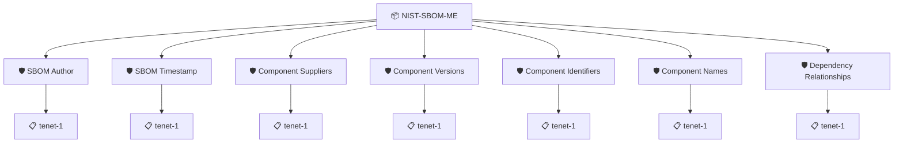

# NTIA SBOM Minimum Elements

Checks that a Software Bill of Materials carries the minimum elements defined by NTIA in *The Minimum Elements for a Software Bill of Materials* (2021): the author and timestamp of the SBOM, and the supplier, name, version, identifiers and dependency relationships of every top-level component.

For the 2026 update of these elements by CISA see the `CISA-SBOM-2026` group.

## Overview

| Property | Value |
|----------|-------|
| **Type** | PolicySet |
| **ID** | `NIST-SBOM-ME` |
| **Enforce** | ON |
| **Policies** | 7 |

## Structure



## Policies

### SBOM Author

Checks that the SBOM names the author of the SBOM data.

#### Overview

| Property | Value |
|----------|-------|
| **Type** | Policy |
| **ID** | `NIST-ME-AUTHOR` |
| **Assert mode** | AND |
| **Tenets** | 1 |
| **Enforce** | ON |

#### Tenets

##### Tenet: `tenet-1`

**Evaluation:**
```cel
size(outputs.authors) > 0
```

**Outputs:**
- `authors`: `size(sboms) > 0 ? sboms[0].get_authors() : []`

**On pass:** SBOM author defined

**On fail:** SBOM document has no authors defined
**Guidance:** Ensure the document has author information set in its metadata

### SBOM Timestamp

Checks that the SBOM records when it was generated.

#### Overview

| Property | Value |
|----------|-------|
| **Type** | Policy |
| **ID** | `NIST-ME-TIMESTAMP` |
| **Assert mode** | AND |
| **Tenets** | 1 |
| **Enforce** | ON |

#### Tenets

##### Tenet: `tenet-1`

**Evaluation:**
```cel
int(outputs.date) > 0
```

**Outputs:**
- `date`: `size(sboms) > 0 ? sboms[0].get_metadata().date : null`

**On pass:** SBOM contains a timestamp

### Component Suppliers

Checks that every top-level component of the SBOM names its supplier.

#### Overview

| Property | Value |
|----------|-------|
| **Type** | Policy |
| **ID** | `NIST-ME-SUPPLIER` |
| **Assert mode** | AND |
| **Tenets** | 1 |
| **Enforce** | ON |

#### Tenets

##### Tenet: `tenet-1`

**Evaluation:**
```cel
outputs.suppliers.all(s, size(s) > 0)
```

**Outputs:**
- `suppliers`: `sboms[0].get_node_list().get_root_nodes().map(n, n.suppliers)`

**On pass:** All top level components have supplier info

### Component Versions

Checks that every top-level component of the SBOM has a version.

#### Overview

| Property | Value |
|----------|-------|
| **Type** | Policy |
| **ID** | `NIST-ME-VERSION` |
| **Assert mode** | AND |
| **Tenets** | 1 |
| **Enforce** | ON |

#### Tenets

##### Tenet: `tenet-1`

**Evaluation:**
```cel
outputs.versions.all(s, s != "")
```

**Outputs:**
- `versions`: `sboms[0].get_node_list().get_root_nodes().map(s, s.version)`

**On pass:** All top level components have versions

### Component Identifiers

Checks that every top-level component of the SBOM carries at least one software identifier, such as a package URL or a CPE.

#### Overview

| Property | Value |
|----------|-------|
| **Type** | Policy |
| **ID** | `NIST-ME-IDENTIFIERS` |
| **Assert mode** | AND |
| **Tenets** | 1 |
| **Enforce** | ON |

#### Tenets

##### Tenet: `tenet-1`

**Evaluation:**
```cel
outputs.identifiers.all(s, size(s) > 0)
```

**Outputs:**
- `identifiers`: `sboms[0].get_node_list().get_root_nodes().map(n, n.identifiers)`

**On pass:** Top level components have software identifiers

### Component Names

Checks that every top-level component of the SBOM has a name.

#### Overview

| Property | Value |
|----------|-------|
| **Type** | Policy |
| **ID** | `NIST-ME-NAME` |
| **Assert mode** | AND |
| **Tenets** | 1 |
| **Enforce** | ON |

#### Tenets

##### Tenet: `tenet-1`

**Evaluation:**
```cel
outputs.names.all(s, s != "")
```

**Outputs:**
- `names`: `sboms[0].get_node_list().get_root_nodes().map(s, s.name)`

**On pass:** Top level components have their name set

### Dependency Relationships

Checks that every top-level component of the SBOM records its dependency relationships.

#### Overview

| Property | Value |
|----------|-------|
| **Type** | Policy |
| **ID** | `NIST-ME-RELATONSHIPS` |
| **Assert mode** | AND |
| **Tenets** | 1 |
| **Enforce** | OFF |

#### Tenets

##### Tenet: `tenet-1`

**Evaluation:**
```cel
outputs.descendants.all(nl, size(nl.get_edges()) > 0)
```

**Outputs:**
- `descendants`: `sboms[0].get_node_list().get_root_nodes().map(n, sboms[0].get_node_list().get...`

**On pass:** All top level components have depedency relationships

