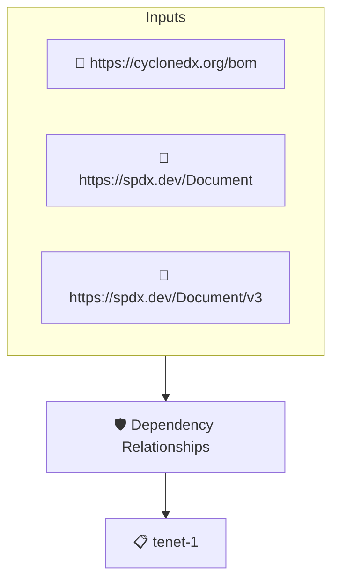

# Dependency Relationships

Checks that every top-level component of the SBOM records its dependency relationships.

## Overview

| Property | Value |
|----------|-------|
| **Type** | Policy |
| **ID** | `NIST-ME-RELATIONSHIPS` |
| **Assert mode** | AND |
| **Tenets** | 1 |
| **Enforce** | OFF |

## Structure



## Tenets

### Tenet: `tenet-1`

**Evaluation:**
```cel
outputs.descendants.all(nl, size(nl.get_edges()) > 0)
```

**Outputs:**
- `descendants`: `sboms[0].get_node_list().get_root_nodes().map(n, sboms[0].get_node_list().get...`

**On pass:** All top level components have depedency relationships

