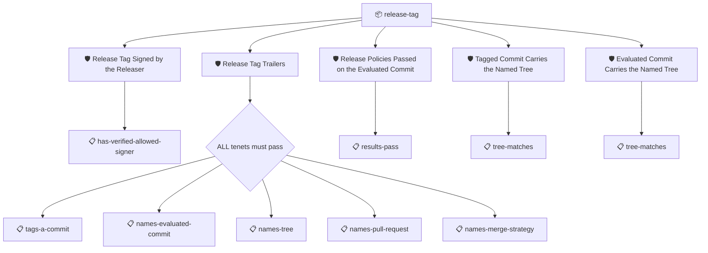

# Release Tag

Verifies a release tag cut on the commit a merge produced while the
release policies were evaluated on the pull request's head. The
subject is the **tagged commit**, what a builder checks out at the
tag, so a build at the tag can find the evaluation results and gate
on them. The tag's signed trailers are the link: the set checks the
tag is signed by the releaser, that its trailers are present and
well formed, that the evaluated commit carries a passing results
attestation signed by the releaser, and that both the tagged
commit and the evaluated commit carry the tree the tag names, so
what was released is what was evaluated. The evaluated commit is
derived from git where git can give it, a merge commit's second
parent; a squash or a rebase rewrites history, and only then is the
`Evaluated-Commit` trailer load-bearing.

The releaser is pinned by the `releaser` and `releaser_issuer`
context values, matched by the tenets against the verified
signers, so the run passes no `--signer`: a signer constraint
would wrongly apply to the git objects the chains cross, which
are proven by their hashes, not by who signed them.

The evidence comes from two collectors:
`git:https://github.com/ORG/REPO@v1.2.0` describes the tag and the
commits with their signatures verified (the evaluated commit
fetched on demand when no branch reaches it), and
`dnote:https://github.com/ORG/REPO` serves the evaluated commit's
results from its git note.

## Overview

| Property | Value |
|----------|-------|
| **Type** | PolicySet |
| **ID** | `release-tag` |
| **Enforce** | ON |
| **Policies** | 5 |

## Structure



## Policies

### Release Tag Signed by the Releaser

Passes when the subject git tag carries a verified signature from
an accepted signer: the releaser, such as miniprow's sigstore
identity.

The tag is the releaser's claim that the release policies passed
on the evaluated commit and that the tagged commit carries the
evaluated tree. The claim is worth exactly as much as the
signature on it, so this policy requires the tag attestation's
verification to be set, verified, and matched to a sigstore
identity. Which identity is accepted is AMPEL's decision, from
`--signer` or the policy's `identities`; this tenet rejects an
empty match and a key or reference identity.

The git tag attestation (`https://carabiner.dev/git/tag/v0`) is
synthesized by the carabiner git collector from the tag object;
its verification is the tag's own signature, checked by the
collector: a sigstore signature against the Fulcio chain and the
Rekor log, or a PGP signature against the keys it holds.

## Verifying

```
ampel verify --subject-hash sha1:<tag object sha> \
    -c git:https://github.com/ORG/REPO@v1.2.0 \
    -p git+https://github.com/carabiner-dev/policies#release/release-tag-signed.json \
    --signer 'sigstore::https://token.actions.githubusercontent.com::<releaser identity>'
```

#### Overview

| Property | Value |
|----------|-------|
| **Type** | Policy |
| **ID** | `release-tag-signed` |
| **Assert mode** | AND |
| **Tenets** | 1 |
| **Enforce** | ON |

#### Tenets

##### Tenet: `has-verified-allowed-signer`

**Evaluation:**
```cel
predicates.exists(p,
    p.verification.verified &&
    size(p.verification.identities) > 0 &&
    p.verification.identities.all(i, has(i.sigstore))
)
```

**On pass:** The tag is signed by an accepted releaser

**On fail:** The tag is not signed by an accepted releaser
**Guidance:** The tag must carry a verified signature whose signer matches an accepted sigstore identity. Pass the releaser's identity with --signer 'sigstore::<issuer>::<identity>' or declare it in the policy; an unsigned tag, or one signed by a key or an unmatched identity, is rejected.

### Release Tag Trailers

Passes when the subject is an annotated git tag on a commit whose
message carries the trailers a release tag needs to be verified
back to the commit the policies were evaluated on.

A release tag cut by a tagger such as miniprow lands on the commit
the merge produced, while the policies were evaluated on the pull
request's head. The tag's trailers are the signed link between the
two: `Evaluated-Commit` names the head, `Tree` the tree both
commits share, `Pull-Request` the pull request, and
`Merge-Strategy` how the head reached the branch. This policy
checks the trailers are present and well formed; the other
policies in the `release-tag` set follow them.

The tag is described by a git tag attestation
(`https://carabiner.dev/git/tag/v0`), synthesized by the carabiner
git collector from the tag object itself with the message's
trailers parsed as git defines them.

#### Overview

| Property | Value |
|----------|-------|
| **Type** | Policy |
| **ID** | `release-tag-trailers` |
| **Assert mode** | AND |
| **Tenets** | 5 |
| **Enforce** | ON |

#### Tenets

##### Tenet: `tags-a-commit`

**Evaluation:**
```cel
predicate.data.objectType == "commit"
```

**On pass:** The tag points at a commit

**On fail:** The tag does not point at a commit
**Guidance:** A release tag must point at the commit the release is cut from, not at another tag, a tree or a blob.

##### Tenet: `names-evaluated-commit`

**Evaluation:**
```cel
has(predicate.data.trailers) &&
"Evaluated-Commit" in predicate.data.trailers &&
predicate.data.trailers["Evaluated-Commit"].size() == 1 &&
predicate.data.trailers["Evaluated-Commit"][0].matches("^[0-9a-f]{40}$")
```

**On pass:** The tag names the commit the policies were evaluated on

**On fail:** The tag does not name the evaluated commit
**Guidance:** The tag message must end with exactly one `Evaluated-Commit: <sha>` trailer naming the commit the release policies were evaluated on, as a full 40-character sha.

##### Tenet: `names-tree`

**Evaluation:**
```cel
has(predicate.data.trailers) &&
"Tree" in predicate.data.trailers &&
predicate.data.trailers["Tree"].size() == 1 &&
predicate.data.trailers["Tree"][0].matches("^[0-9a-f]{40}$")
```

**On pass:** The tag names the tree the tagged and the evaluated commits share

**On fail:** The tag does not name the released tree
**Guidance:** The tag message must end with exactly one `Tree: <sha>` trailer naming the tree both the tagged commit and the evaluated commit carry.

##### Tenet: `names-pull-request`

**Evaluation:**
```cel
has(predicate.data.trailers) &&
"Pull-Request" in predicate.data.trailers &&
predicate.data.trailers["Pull-Request"].size() == 1 &&
predicate.data.trailers["Pull-Request"][0].matches("^[1-9][0-9]*$")
```

**On pass:** The tag names the pull request the release came from

**On fail:** The tag does not name the pull request
**Guidance:** The tag message must end with exactly one `Pull-Request: <number>` trailer. A squashed or rebased head is only reachable through the pull request's ref, so a verifier needs the number.

##### Tenet: `names-merge-strategy`

**Evaluation:**
```cel
has(predicate.data.trailers) &&
"Merge-Strategy" in predicate.data.trailers &&
predicate.data.trailers["Merge-Strategy"][0] in ["merge", "squash", "rebase"]
```

**On pass:** The tag states how the evaluated commit reached the branch

**On fail:** The tag does not state a known merge strategy
**Guidance:** The tag message must end with a `Merge-Strategy: merge|squash|rebase` trailer.

### Release Policies Passed on the Evaluated Commit

Passes when the commit the release policies were evaluated on, the
pull request's head, carries an AMPEL results attestation whose
verdict is PASS.

The policy reaches that commit from the tag through git wherever
git can give it: for a merge commit the evaluated head is the
merge's second parent, read from the tagged commit's own
attestation (`https://carabiner.dev/git/commit/v0`). A squash or
a rebase rewrites history and leaves no link, so for those the
chain reads the tag's `Evaluated-Commit` trailer, the one place
the trailer is load-bearing. `Merge-Strategy` says which path
applies. The tenets then evaluate on the head, reading the
results attestation (`https://carabiner.dev/ampel/resultset/v0`)
the releaser stored for it. The head may no longer be on any
branch, so the collector must reach it through the pull request's
ref (`refs/pull/N/head` on GitHub) or by its sha.

Which releaser's results are trusted is AMPEL's decision, from
`--signer` or the policy's `identities`.

#### Overview

| Property | Value |
|----------|-------|
| **Type** | Policy |
| **ID** | `release-evaluated-commit-passed` |
| **Assert mode** | AND |
| **Tenets** | 1 |
| **Enforce** | ON |

#### Tenets

##### Tenet: `results-pass`

**Evaluation:**
```cel
predicates.exists(p, p.data.status == "PASS" && size(p.data.results) > 0)
```

**On pass:** The release policies passed on the evaluated commit

**On fail:** No passing results attestation for the evaluated commit
**Guidance:** The commit the release policies were evaluated on must carry a results attestation with at least one result and a PASS verdict, stored by the releaser at the time of the release.

### Tagged Commit Carries the Named Tree

Passes when the commit the release tag points at carries the tree
the tag's `Tree` trailer names.

A release tag lands on the commit a merge produced while the
policies were evaluated on the pull request's head; what makes
the tag honest is that both commits carry the same tree. The tag
names that tree in its signed `Tree` trailer. This policy chains
from the tag to the tagged commit and checks the commit's own
tree, read from its attestation (`https://carabiner.dev/git/commit/v0`,
synthesized from the commit object), against the trailer. Its
sibling `release-evaluated-commit-tree` does the same for the
evaluated commit; together they establish the two trees are one.

#### Overview

| Property | Value |
|----------|-------|
| **Type** | Policy |
| **ID** | `release-tagged-commit-tree` |
| **Assert mode** | AND |
| **Tenets** | 1 |
| **Enforce** | ON |

#### Tenets

##### Tenet: `tree-matches`

**Evaluation:**
```cel
predicate.data.tree == chain[0].predicate.data.trailers["Tree"][0]
```

**On pass:** The tagged commit carries the tree the tag names

**On fail:** The tagged commit does not carry the tree the tag names
**Guidance:** The release tag's Tree trailer must name the tagged commit's tree. A tag whose target carries another tree was cut on content the policies never saw.

### Evaluated Commit Carries the Named Tree

Passes when the commit the release policies were evaluated on
carries the tree the tag's `Tree` trailer names.

The evaluated commit is reached as `release-evaluated-commit-passed`
reaches it: the merge's second parent for a merge commit, the
`Evaluated-Commit` trailer for a squash or a rebase. Its tree,
read from its attestation (`https://carabiner.dev/git/commit/v0`),
must be the one the tag names. With `release-tagged-commit-tree`
this establishes that the tagged commit and the evaluated commit
carry the same tree: what was released is what was evaluated.

#### Overview

| Property | Value |
|----------|-------|
| **Type** | Policy |
| **ID** | `release-evaluated-commit-tree` |
| **Assert mode** | AND |
| **Tenets** | 1 |
| **Enforce** | ON |

#### Tenets

##### Tenet: `tree-matches`

**Evaluation:**
```cel
predicate.data.tree == chain[0].predicate.data.trailers["Tree"][0]
```

**On pass:** The evaluated commit carries the tree the tag names

**On fail:** The evaluated commit does not carry the tree the tag names
**Guidance:** The release tag's Tree trailer must name the evaluated commit's tree, the content the policies passed on.

