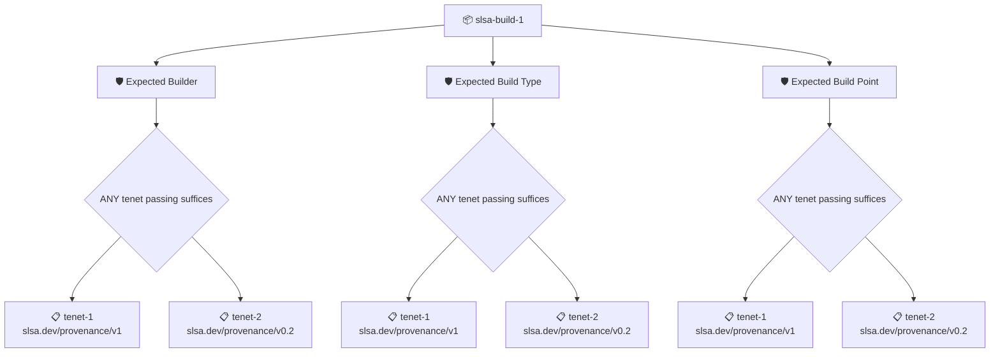

# SLSA Build Level 1

Verifies that an artifact was built on a SLSA Build Level 1 system by checking its SLSA provenance against the level's requirements. Each policy in the set is referenced from this repository and mapped to the SLSA BUILD control it covers.

## Overview

| Property | Value |
|----------|-------|
| **Type** | PolicySet |
| **ID** | `slsa-build-1` |
| **Enforce** | ON |
| **Policies** | 3 |

## Structure



## Policies

### Expected Builder

Checks that the builder recorded in the artifact's SLSA provenance matches the `builderId` context value, either exactly or as a prefix followed by `@`.

#### Overview

| Property | Value |
|----------|-------|
| **Type** | Policy |
| **ID** | `slsa-builder-id` |
| **Assert mode** | OR |
| **Tenets** | 2 |
| **Enforce** | ON |

#### Context Values

| Name | Type | Required | Default |
|------|------|----------|---------|
| `builderId` | string | **yes** |  |

#### Tenets

##### Tenet: `tenet-1`

**Attestation types:**
- `https://slsa.dev/provenance/v1`

**Evaluation:**
```cel
outputs.builderId == context.builderId || outputs.builderId.startsWith(context.builderId + '@')
```

**Outputs:**
- `builderId`: `has(predicates[0].data.runDetails) ? (has(predicates[0].data.runDetails.build...`

**On pass:** Authorized builder ID detected

**On fail:** Builder identifier mismatch
**Guidance:** The attestation builder does not match the context defined builder (want {{ .Context.builderId }} got {{ .Outputs.builderId }})

##### Tenet: `tenet-2`

**Attestation types:**
- `https://slsa.dev/provenance/v0.2`

**Evaluation:**
```cel
outputs.builderId == context.builderId || outputs.builderId.startsWith(context.builderId + '@')
```

**Outputs:**
- `builderId`: `has(predicates[0].data.builder) ? (has(predicates[0].data.builder.id) ? predi...`

**On pass:** Authorized builder ID detected

**On fail:** Builder identifier mismatch
**Guidance:** The attestation builder does not match the context defined builder (want {{ .Context.builderId }} got {{ .Outputs.builderId }})

### Expected Build Type

Checks that the build type recorded in the artifact's SLSA provenance matches the `buildType` context value, either exactly or as a prefix followed by `@`.

#### Overview

| Property | Value |
|----------|-------|
| **Type** | Policy |
| **ID** | `slsa-build-type` |
| **Assert mode** | OR |
| **Tenets** | 2 |
| **Enforce** | ON |

#### Context Values

| Name | Type | Required | Default |
|------|------|----------|---------|
| `buildType` | string | **yes** |  |

#### Tenets

##### Tenet: `tenet-1`

**Attestation types:**
- `https://slsa.dev/provenance/v1`

**Evaluation:**
```cel
outputs.buildType == context.buildType || outputs.buildType.startsWith(context.buildType + '@')
```

**Outputs:**
- `buildType`: `has(predicates[0].data.buildDefinition) ? (has(predicates[0].data.buildDefini...`

**On pass:** Expected buildType found: {{ .Outputs.buildType  }}

**On fail:** BuildType mismatch
**Guidance:** The attested build type ({{ .Outputs.buildType }}) does not match the expected identifier

##### Tenet: `tenet-2`

**Attestation types:**
- `https://slsa.dev/provenance/v0.2`

**Evaluation:**
```cel
outputs.buildType == context.buildType || outputs.buildType.startsWith(context.buildType + '@')
```

**Outputs:**
- `buildType`: `has(predicates[0].data.buildType) ? predicates[0].data.buildType : '' `

**On pass:** Expected buildType found: {{ .Outputs.buildType  }}

**On fail:** BuildType mismatch
**Guidance:** The attested build type ({{ .Outputs.buildType }}) does not match the expected identifier

### Expected Build Point

Checks that the artifact's SLSA provenance records the expected source repository and commit, given as the `buildPoint` context value, among its resolved dependencies.

#### Overview

| Property | Value |
|----------|-------|
| **Type** | Policy |
| **ID** | `slsa-build-point` |
| **Assert mode** | OR |
| **Tenets** | 2 |
| **Enforce** | ON |

#### Context Values

| Name | Type | Required | Default |
|------|------|----------|---------|
| `buildPoint` | string | **yes** |  |
| `buildPointAllowRepo` | bool | no | `true` |
| `buildPointCommit` | string | no | `` |

#### Tenets

##### Tenet: `tenet-1`

**Attestation types:**
- `https://slsa.dev/provenance/v1`

**Evaluation:**
```cel
outputs.uri != '' && (context.buildPointAllowRepo || outputs.uri == context.buildPoint) && (context.buildPointCommit == '' || outputs.commitMatch)
```

**Outputs:**
- `commitMatch`: `context.buildPointCommit != '' && has(predicate.data.buildDefinition) && has(...`
- `uri`: `has(predicate.data.buildDefinition) && has(predicate.data.buildDefinition.res...`

**On pass:** Expected build point found: {{ .Context.buildPoint }}

**On fail:** Build point mismatch
**Guidance:** The attested build point does not match the expected reference

##### Tenet: `tenet-2`

**Attestation types:**
- `https://slsa.dev/provenance/v0.2`

**Evaluation:**
```cel
outputs.uri != '' && (context.buildPointAllowRepo || outputs.uri == context.buildPoint) && (context.buildPointCommit == '' || outputs.commitMatch)
```

**Outputs:**
- `commitMatch`: `context.buildPointCommit != '' && has(predicate.data.materials) && predicate....`
- `uri`: `has(predicate.data.materials) && predicate.data.materials.exists(dep, has(dep...`

**On pass:** Expected build point found: {{ .Context.buildPoint }}

**On fail:** Build point mismatch
**Guidance:** The attested build point does not match the expected reference

