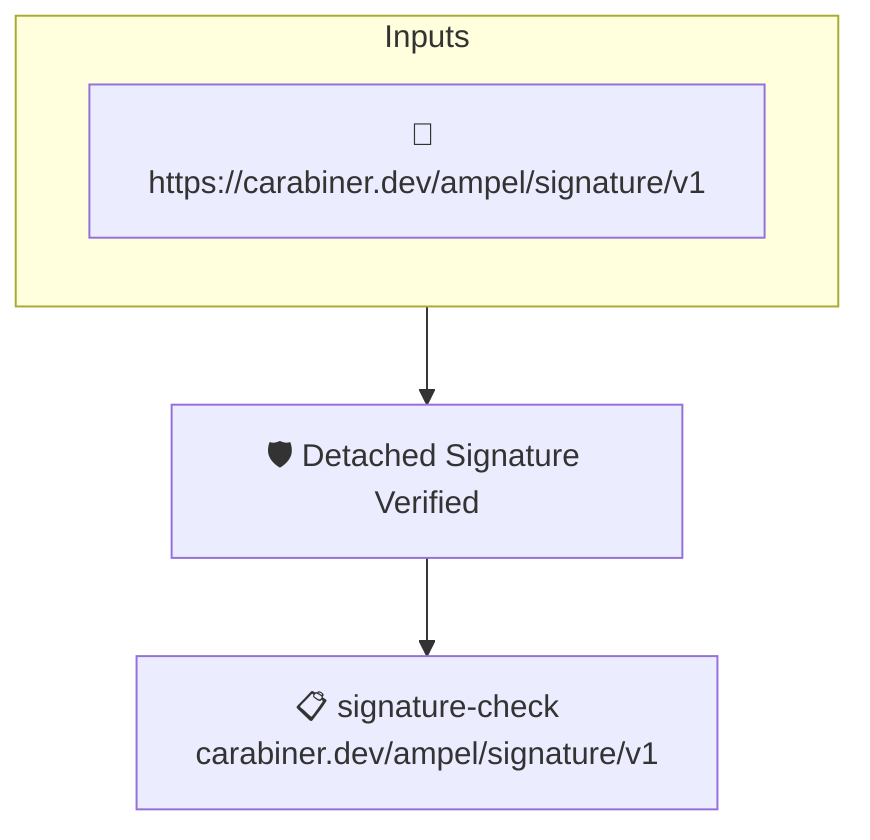

# Detached Signature Verified

Checks that the artifact carries a verified detached signature or sigstore bundle from an accepted signer. The signer identity is matched by AMPEL against the identities given at verification time or declared in the policy.

## Overview

| Property | Value |
|----------|-------|
| **Type** | Policy |
| **ID** | `detached-signature` |
| **Assert mode** | AND |
| **Tenets** | 1 |
| **Enforce** | ON |

## Structure



## Tenets

### Tenet: `signature-check`

**Attestation types:**
- `https://carabiner.dev/ampel/signature/v1`

**Evaluation:**
```cel
size(predicates) > 0
```

**On pass:** Signature verfiied

**On fail:** No detached signature found
**Guidance:** No signature found or unkown key

