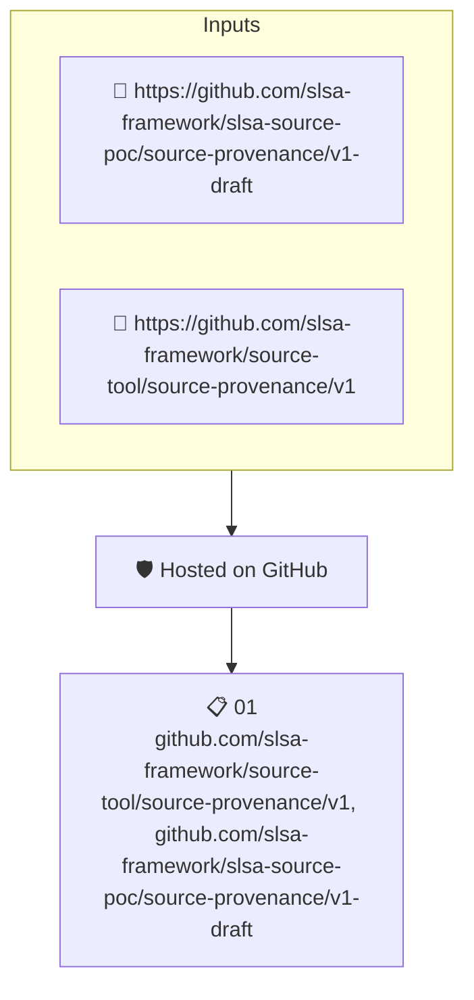

# Hosted on GitHub

Checks the repository's SLSA source provenance to establish that the repository is hosted in a GitHub organization.

## Overview

| Property | Value |
|----------|-------|
| **Type** | Policy |
| **ID** | `SLSA-SRC-GHORG` |
| **Assert mode** | AND |
| **Tenets** | 1 |
| **Enforce** | ON |

## Structure



## Tenets

### Tenet: `01`

**Attestation types:**
- `https://github.com/slsa-framework/source-tool/source-provenance/v1`
- `https://github.com/slsa-framework/slsa-source-poc/source-provenance/v1-draft`

**Evaluation:**
```cel
outputs.org.name.indexOf('github.com') == 0 
```

**Outputs:**
- `org`: `github.orgDescriptorFromURI(predicate.data.repoUri)`

**On pass:** GitHub organization found in SLSA provenance

