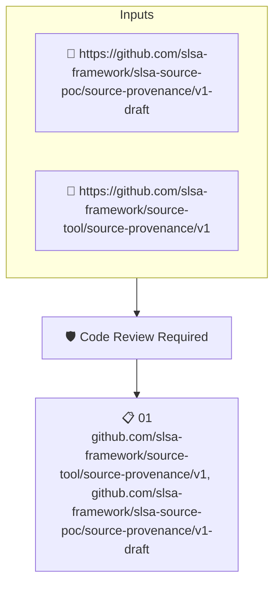

# Code Review Required

Checks the repository's SLSA source provenance for the property recording that changes require code review.

## Overview

| Property | Value |
|----------|-------|
| **Type** | Policy |
| **ID** | `SLSA-SRC-REVIEW` |
| **Assert mode** | AND |
| **Tenets** | 1 |
| **Enforce** | ON |

## Structure



## Tenets

### Tenet: `01`

**Attestation types:**
- `https://github.com/slsa-framework/source-tool/source-provenance/v1`
- `https://github.com/slsa-framework/slsa-source-poc/source-provenance/v1-draft`

**Evaluation:**
```cel
outputs.controls.one(c, c == 'REVIEW_ENFORCED')
```

**Outputs:**
- `controls`: `predicates[0].data.controls.map(c, c.name)`

**On pass:** Repository enforces code review

