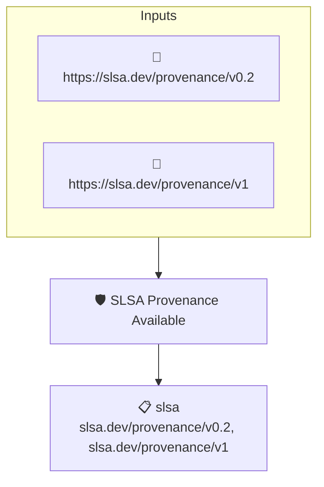

# SLSA Provenance Available

Checks that a SLSA provenance attestation describing how the artifact was built is available.

## Overview

| Property | Value |
|----------|-------|
| **Type** | Policy |
| **ID** | `slsa-has-attestation` |
| **Assert mode** | AND |
| **Tenets** | 1 |
| **Enforce** | ON |

## Structure



## Tenets

### Tenet: `slsa`

**Attestation types:**
- `https://slsa.dev/provenance/v0.2`
- `https://slsa.dev/provenance/v1`

**Evaluation:**
```cel
size(predicates) > 0
```

**On pass:** SLSA provenance attestation found

**On fail:** No SLSA attestation found
**Guidance:** Capture the build process in a SLSA provenance attestation

