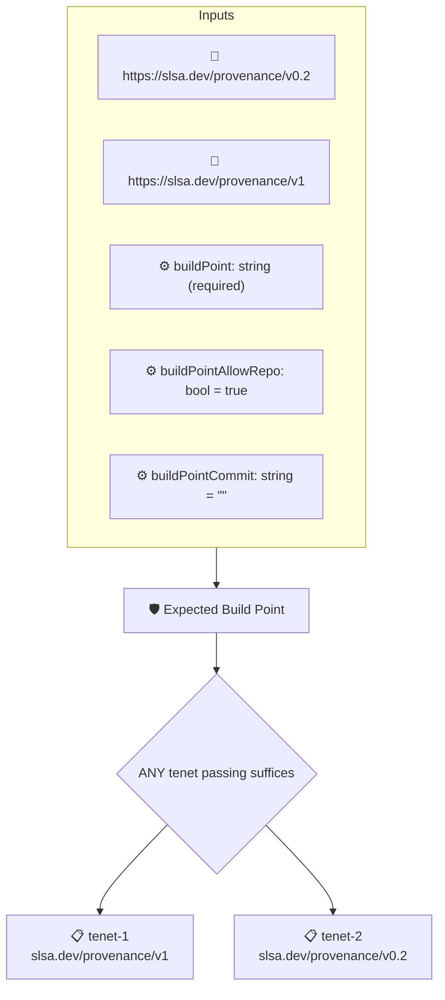

# Expected Build Point

Checks that the artifact's SLSA provenance records the expected source repository and commit, given as the `buildPoint` context value, among its resolved dependencies.

## Overview

| Property | Value |
|----------|-------|
| **Type** | Policy |
| **ID** | `slsa-build-point` |
| **Assert mode** | OR |
| **Tenets** | 2 |
| **Enforce** | ON |

## Context Values

| Name | Type | Required | Default |
|------|------|----------|---------|
| `buildPoint` | string | **yes** |  |
| `buildPointAllowRepo` | bool | no | `true` |
| `buildPointCommit` | string | no | `` |

## Structure



## Tenets

### Tenet: `tenet-1`

**Attestation types:**
- `https://slsa.dev/provenance/v1`

**Evaluation:**
```cel
outputs.uri != '' && (context.buildPointAllowRepo || outputs.uri == context.buildPoint) && (context.buildPointCommit == '' || outputs.commitMatch)
```

**Outputs:**
- `commitMatch`: `context.buildPointCommit != '' && has(predicate.data.buildDefinition) && has(...`
- `uri`: `has(predicate.data.buildDefinition) && has(predicate.data.buildDefinition.res...`

**On pass:** Expected build point found: {{ .Context.buildPoint }}

**On fail:** Build point mismatch
**Guidance:** The attested build point does not match the expected reference

### Tenet: `tenet-2`

**Attestation types:**
- `https://slsa.dev/provenance/v0.2`

**Evaluation:**
```cel
outputs.uri != '' && (context.buildPointAllowRepo || outputs.uri == context.buildPoint) && (context.buildPointCommit == '' || outputs.commitMatch)
```

**Outputs:**
- `commitMatch`: `context.buildPointCommit != '' && has(predicate.data.materials) && predicate....`
- `uri`: `has(predicate.data.materials) && predicate.data.materials.exists(dep, has(dep...`

**On pass:** Expected build point found: {{ .Context.buildPoint }}

**On fail:** Build point mismatch
**Guidance:** The attested build point does not match the expected reference

