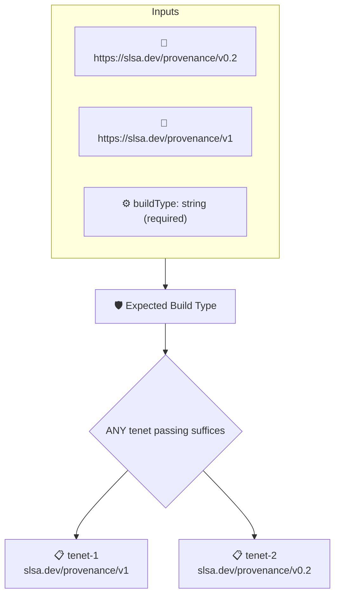

# Expected Build Type

Checks that the build type recorded in the artifact's SLSA provenance matches the `buildType` context value, either exactly or as a prefix followed by `@`.

## Overview

| Property | Value |
|----------|-------|
| **Type** | Policy |
| **ID** | `slsa-build-type` |
| **Assert mode** | OR |
| **Tenets** | 2 |
| **Enforce** | ON |

## Context Values

| Name | Type | Required | Default |
|------|------|----------|---------|
| `buildType` | string | **yes** |  |

## Structure



## Tenets

### Tenet: `tenet-1`

**Attestation types:**
- `https://slsa.dev/provenance/v1`

**Evaluation:**
```cel
outputs.buildType == context.buildType || outputs.buildType.startsWith(context.buildType + '@')
```

**Outputs:**
- `buildType`: `has(predicates[0].data.buildDefinition) ? (has(predicates[0].data.buildDefini...`

**On pass:** Expected buildType found: {{ .Outputs.buildType  }}

**On fail:** BuildType mismatch
**Guidance:** The attested build type ({{ .Outputs.buildType }}) does not match the expected identifier

### Tenet: `tenet-2`

**Attestation types:**
- `https://slsa.dev/provenance/v0.2`

**Evaluation:**
```cel
outputs.buildType == context.buildType || outputs.buildType.startsWith(context.buildType + '@')
```

**Outputs:**
- `buildType`: `has(predicates[0].data.buildType) ? predicates[0].data.buildType : '' `

**On pass:** Expected buildType found: {{ .Outputs.buildType  }}

**On fail:** BuildType mismatch
**Guidance:** The attested build type ({{ .Outputs.buildType }}) does not match the expected identifier

