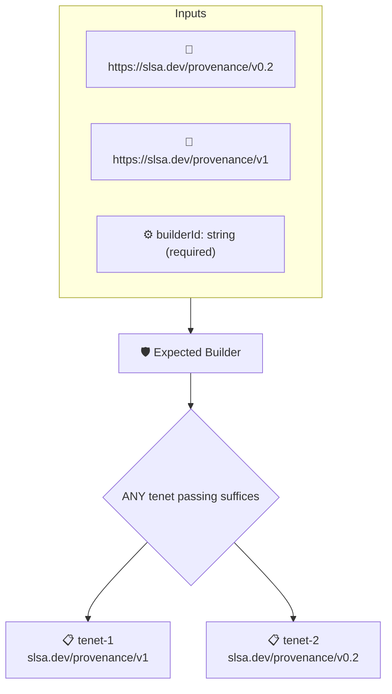

# Expected Builder

Checks that the builder recorded in the artifact's SLSA provenance matches the `builderId` context value, either exactly or as a prefix followed by `@`.

## Overview

| Property | Value |
|----------|-------|
| **Type** | Policy |
| **ID** | `slsa-builder-id` |
| **Assert mode** | OR |
| **Tenets** | 2 |
| **Enforce** | ON |

## Context Values

| Name | Type | Required | Default |
|------|------|----------|---------|
| `builderId` | string | **yes** |  |

## Structure



## Tenets

### Tenet: `tenet-1`

**Attestation types:**
- `https://slsa.dev/provenance/v1`

**Evaluation:**
```cel
outputs.builderId == context.builderId || outputs.builderId.startsWith(context.builderId + '@')
```

**Outputs:**
- `builderId`: `has(predicates[0].data.runDetails) ? (has(predicates[0].data.runDetails.build...`

**On pass:** Authorized builder ID detected

**On fail:** Builder identifier mismatch
**Guidance:** The attestation builder does not match the context defined builder (want {{ .Context.builderId }} got {{ .Outputs.builderId }})

### Tenet: `tenet-2`

**Attestation types:**
- `https://slsa.dev/provenance/v0.2`

**Evaluation:**
```cel
outputs.builderId == context.builderId || outputs.builderId.startsWith(context.builderId + '@')
```

**Outputs:**
- `builderId`: `has(predicates[0].data.builder) ? (has(predicates[0].data.builder.id) ? predi...`

**On pass:** Authorized builder ID detected

**On fail:** Builder identifier mismatch
**Guidance:** The attestation builder does not match the context defined builder (want {{ .Context.builderId }} got {{ .Outputs.builderId }})

