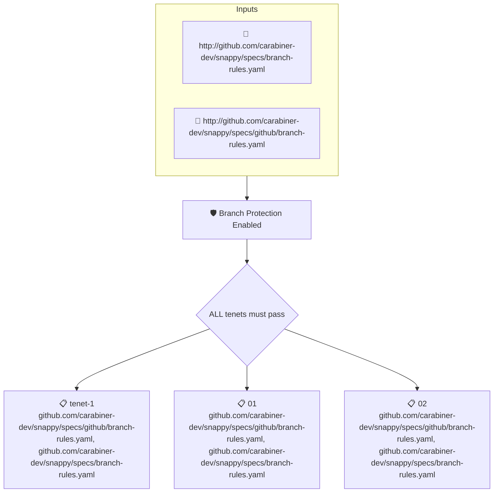

# Branch Protection Enabled

Reads the attested branch protection rules of the repository and fails when force pushes are allowed on the default branch.

## Overview

| Property | Value |
|----------|-------|
| **Type** | Policy |
| **ID** | `SNAPPY-BRANCH-PROTECTION` |
| **Assert mode** | AND |
| **Tenets** | 3 |
| **Enforce** | ON |

## Structure



## Tenets

### Tenet: `tenet-1`

**Attestation types:**
- `http://github.com/carabiner-dev/snappy/specs/github/branch-rules.yaml`
- `http://github.com/carabiner-dev/snappy/specs/branch-rules.yaml`

**Evaluation:**
```cel
size(predicates) > 0
```

**On pass:** Found attested branch protection metadata

### Tenet: `01`

**Attestation types:**
- `http://github.com/carabiner-dev/snappy/specs/github/branch-rules.yaml`
- `http://github.com/carabiner-dev/snappy/specs/branch-rules.yaml`

**Evaluation:**
```cel
has(predicates[0].data.values) ? predicates[0].data.values.exists(rule, rule.type == "non_fast_forward") : false
```

**On pass:** Force pushing is disabled on default branch

**On fail:** Force pushes can be sent to main branch
**Guidance:** Create a branch ruleset protecting your default branch and enable "Block force pushes"

### Tenet: `02`

**Attestation types:**
- `http://github.com/carabiner-dev/snappy/specs/github/branch-rules.yaml`
- `http://github.com/carabiner-dev/snappy/specs/branch-rules.yaml`

**Evaluation:**
```cel
has(predicates[0].data.values) ? predicates[0].data.values.exists(rule, rule.type == "deletion") : false
```

**On pass:** Branch deletion is disabled on default branch

**On fail:** Branch delete protection is not enabled
**Guidance:** Create a branch ruleset protecting your default branch and enable "Restrict deletions"

