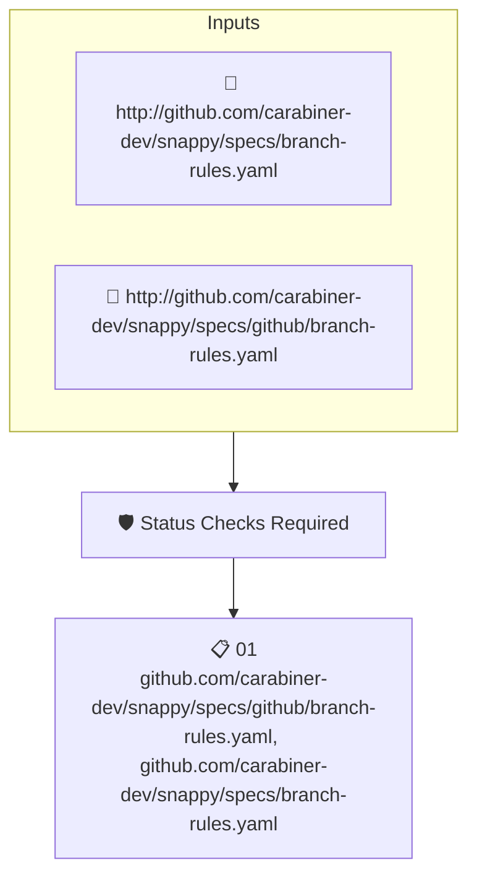

# Status Checks Required

Reads the attested branch protection rules of the repository and fails when pull requests are not required to pass status checks before merging.

## Overview

| Property | Value |
|----------|-------|
| **Type** | Policy |
| **ID** | `SNAPPY-BRANCH-STATUS-CHECKS` |
| **Assert mode** | AND |
| **Tenets** | 1 |
| **Enforce** | ON |

## Structure



## Tenets

### Tenet: `01`

**Attestation types:**
- `http://github.com/carabiner-dev/snappy/specs/github/branch-rules.yaml`
- `http://github.com/carabiner-dev/snappy/specs/branch-rules.yaml`

**Evaluation:**
```cel
has(predicates[0].data.values) ? predicates[0].data.values.exists(rule, rule.type == "required_status_checks") : false
```

**On pass:** Status checks enforced

**On fail:** Add a branch rule to ensure status checks must pass
**Guidance:** Enable "Require status checks to pass" in the repository branch rulesets

