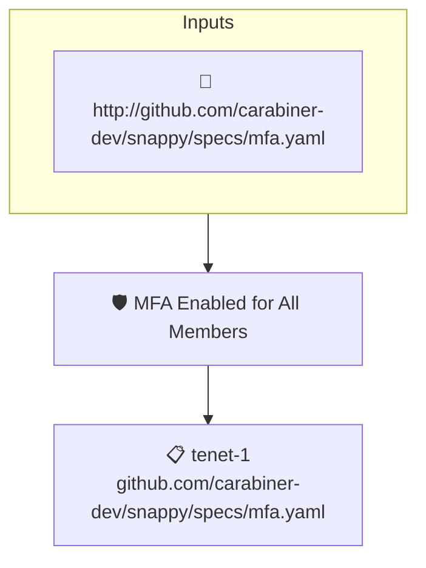

# MFA Enabled for All Members

Reads the attested GitHub organization data and fails when multi-factor authentication is not enabled for all members of the organization.

## Overview

| Property | Value |
|----------|-------|
| **Type** | Policy |
| **ID** | `SNAPPY-MFA-ALL` |
| **Assert mode** | AND |
| **Tenets** | 1 |
| **Enforce** | ON |

## Structure



## Tenets

### Tenet: `tenet-1`

**Attestation types:**
- `http://github.com/carabiner-dev/snappy/specs/mfa.yaml`

**Evaluation:**
```cel
outputs.members.all(member, member.hasTwoFactorEnabled) && size(outputs.members) > 0
```

**Outputs:**
- `members`: `has(predicates[0].data.values.data.organization.membersWithRole) ? (has(predi...`

**On pass:** Multi-factor authentication is enabled for all members in the organization

**On fail:** Multifactor authentication is not enabled for some members
**Guidance:** Enable MFA in the GitHub organization settings to force all members to turn it on

