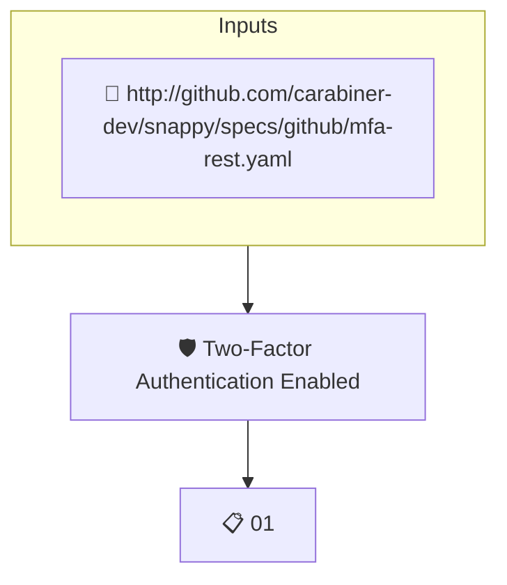

# Two-Factor Authentication Enabled

Reads the attested GitHub organization membership and fails when any member has two-factor authentication disabled.

## Overview

| Property | Value |
|----------|-------|
| **Type** | Policy |
| **ID** | `MFA-ENABLED` |
| **Assert mode** | AND |
| **Tenets** | 1 |
| **Enforce** | ON |

## Structure



## Tenets

### Tenet: `01`

**Evaluation:**
```cel
has(predicates[0].data.values) && size(predicates[0].data.values) == 0
```

**Outputs:**
- `membersWithout2FA`: `has(predicates[0].data.values) ? size(predicates[0].data.values) : -1`

**On pass:** All organization members have two-factor authentication enabled

**On fail:** Organization has members with two-factor authentication disabled
**Guidance:** Review the list of members without 2FA enabled and require them to enable two-factor authentication. In GitHub, navigate to Organization Settings > Authentication security > Require two-factor authentication for everyone in the organization.

