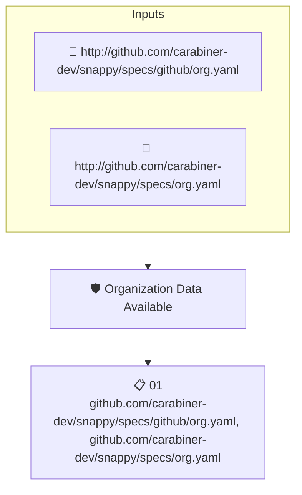

# Organization Data Available

Checks that attested data about the GitHub organization hosting the project is available.

## Overview

| Property | Value |
|----------|-------|
| **Type** | Policy |
| **ID** | `SNAPPY-ORG-EXISTS` |
| **Assert mode** | AND |
| **Tenets** | 1 |
| **Enforce** | ON |

## Structure



## Tenets

### Tenet: `01`

**Attestation types:**
- `http://github.com/carabiner-dev/snappy/specs/github/org.yaml`
- `http://github.com/carabiner-dev/snappy/specs/org.yaml`

**Evaluation:**
```cel
true
```

**On pass:** Attested GitHub organization data found

