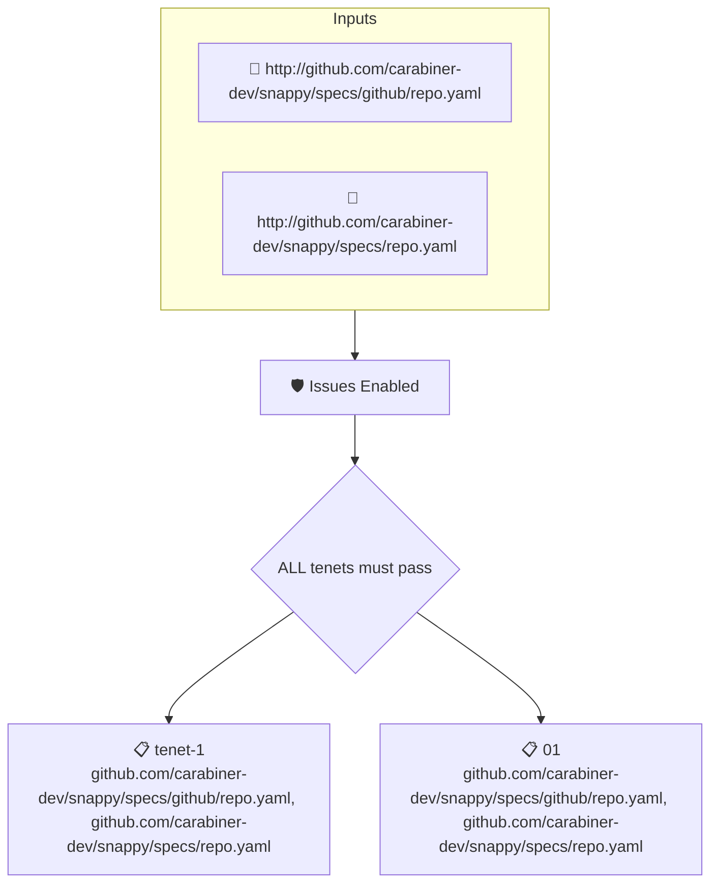

# Issues Enabled

Reads the attested repository data and fails when the issues feature is not enabled.

## Overview

| Property | Value |
|----------|-------|
| **Type** | Policy |
| **ID** | `SNAPPY-REPO-HAS-ISSUES` |
| **Assert mode** | AND |
| **Tenets** | 2 |
| **Enforce** | ON |

## Structure



## Tenets

### Tenet: `tenet-1`

**Attestation types:**
- `http://github.com/carabiner-dev/snappy/specs/github/repo.yaml`
- `http://github.com/carabiner-dev/snappy/specs/repo.yaml`

**Evaluation:**
```cel
size(predicates) > 0
```

**On pass:** Found attested repository data

### Tenet: `01`

**Attestation types:**
- `http://github.com/carabiner-dev/snappy/specs/github/repo.yaml`
- `http://github.com/carabiner-dev/snappy/specs/repo.yaml`

**Evaluation:**
```cel
outputs["issues"]
```

**Outputs:**
- `issues`: `has(predicates[0].data.values.has_issues) ? predicates[0].data.values.has_iss...`

**On pass:** Issues feature is enabled in the repository

**On fail:** Issues are not enabled in the repo
**Guidance:** Turn on the issues setting in the repository

