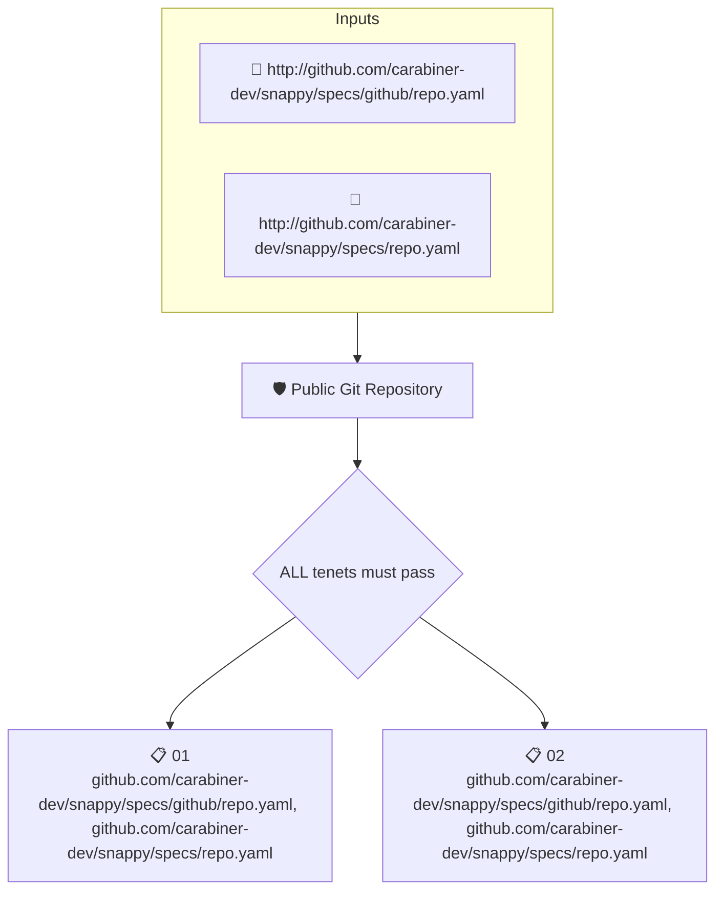

# Public Git Repository

Reads the attested repository data and checks that the repository is public and that its code is stored in git.

## Overview

| Property | Value |
|----------|-------|
| **Type** | Policy |
| **ID** | `SNAPPY-REPO-PUBLIC-GIT` |
| **Assert mode** | AND |
| **Tenets** | 2 |
| **Enforce** | ON |

## Structure



## Tenets

### Tenet: `01`

**Attestation types:**
- `http://github.com/carabiner-dev/snappy/specs/github/repo.yaml`
- `http://github.com/carabiner-dev/snappy/specs/repo.yaml`

**Evaluation:**
```cel
outputs["public"]
```

**Outputs:**
- `public`: `has(predicates[0].data.values.visibility) ? predicates[0].data.values.visibil...`

**On pass:** Code repository is public

**On fail:** Repository is private
**Guidance:** Enable public visibility in the repository settings

### Tenet: `02`

**Attestation types:**
- `http://github.com/carabiner-dev/snappy/specs/github/repo.yaml`
- `http://github.com/carabiner-dev/snappy/specs/repo.yaml`

**Evaluation:**
```cel
outputs["git"] != ''
```

**Outputs:**
- `git`: `has(predicates[0].data.values.git_url) ? predicates[0].data.values.git_url : '' `

**On pass:** Code stored in git repository

**On fail:** No git repository found
**Guidance:** Ensure the project's code is available in git or other VCS

