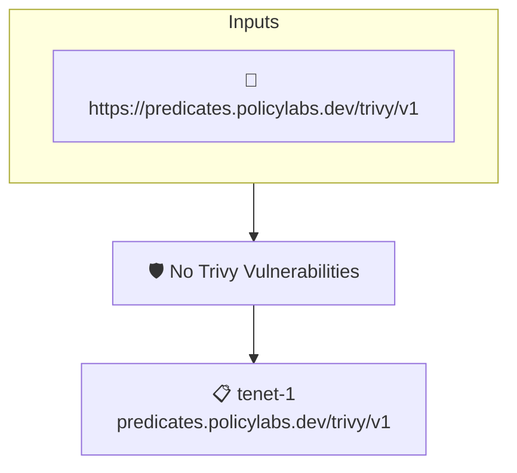

# No Trivy Vulnerabilities

Checks that an attested [trivy](https://github.com/aquasecurity/trivy) vulnerability report contains no vulnerabilities at all.

## Overview

| Property | Value |
|----------|-------|
| **Type** | Policy |
| **ID** | `trivy-no-vulns` |
| **Assert mode** | AND |
| **Tenets** | 1 |
| **Enforce** | ON |

## Structure



## Tenets

### Tenet: `tenet-1`

**Attestation types:**
- `https://predicates.policylabs.dev/trivy/v1`

**Evaluation:**
```cel
outputs.vulnCount == 0
```

**Outputs:**
- `vulnCount`: `has(predicate.data.Results) ? size(predicate.data.Results.map(r, has(r.Vulner...`

**On pass:** Attested trivy report has no vulnerabilities

**On fail:** Attested trivy report has {{ .Outputs.vulnCount }} vulnerabilities
**Guidance:** Remediate or suppress the vulnerabilities reported by trivy before this policy can pass

