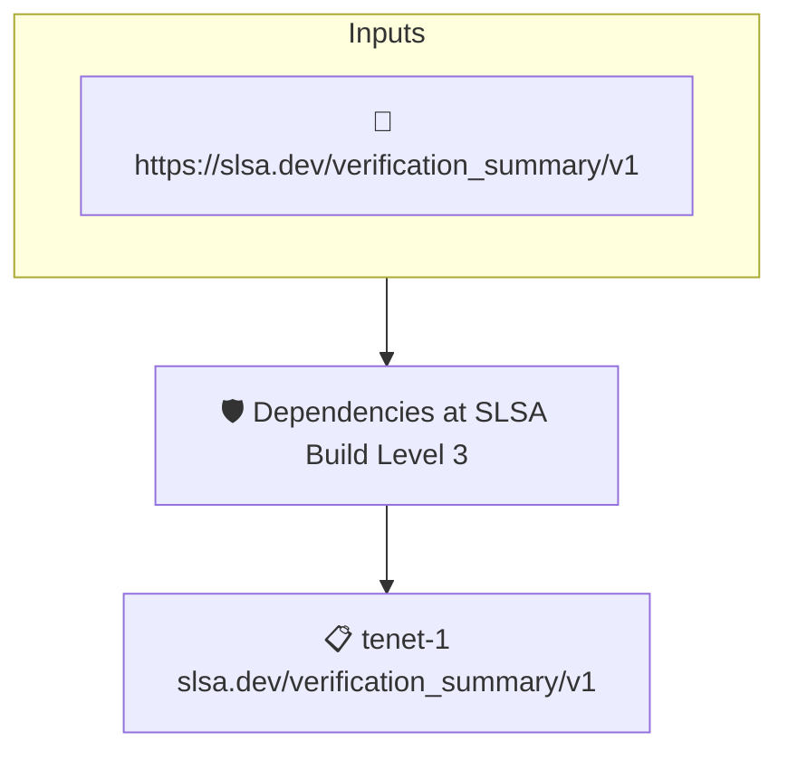

# Dependencies at SLSA Build Level 3

Reads a SLSA Verification Summary Attestation and fails when any of the verified dependencies does not reach SLSA Build Level 3 or higher.

## Overview

| Property | Value |
|----------|-------|
| **Type** | Policy |
| **ID** | `slsa-build-deps-level-3` |
| **Assert mode** | AND |
| **Tenets** | 1 |
| **Enforce** | ON |

## Structure



## Tenets

### Tenet: `tenet-1`

**Attestation types:**
- `https://slsa.dev/verification_summary/v1`

**Evaluation:**
```cel
outputs.levels.filter(level, (outputs.levels[level] != '0' && (level == 'SLSA_BUILD_LEVEL_1' || level == 'SLSA_BUILD_LEVEL_2') )).size() == 0
```

**Outputs:**
- `levels`: `has(predicates[0].data.dependencyLevels) ? predicates[0].data.dependencyLevel...`

**On pass:** All verified dependencies are SLSA_BUILD_LEVEL_3+

**On fail:** Some verified dependencies don't meet SLSA_BUILD_LEVEL_3

