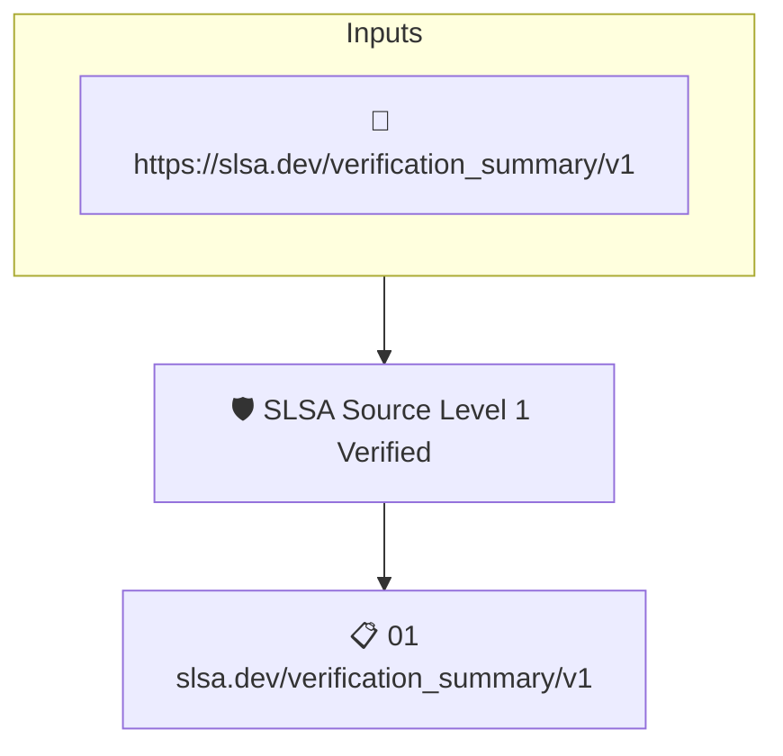

# SLSA Source Level 1 Verified

Checks that a SLSA Verification Summary Attestation records a passed verification at SLSA Source Level 1 or higher.

## Overview

| Property | Value |
|----------|-------|
| **Type** | Policy |
| **ID** | `slsa-source-level-1` |
| **Assert mode** | AND |
| **Tenets** | 1 |
| **Enforce** | ON |

## Structure



## Tenets

### Tenet: `01`

**Attestation types:**
- `https://slsa.dev/verification_summary/v1`

**Evaluation:**
```cel
outputs.pass && outputs.levels.exists(k, v, (v == 'SLSA_SOURCE_LEVEL_1' || v == 'SLSA_SOURCE_LEVEL_2' || v == 'SLSA_SOURCE_LEVEL_3' || v == 'SLSA_SOURCE_LEVEL_4'))
```

**Outputs:**
- `levels`: `has(predicates[0].data.verifiedLevels) ? predicates[0].data.verifiedLevels : [] `
- `pass`: `has(predicates[0].data.verificationResult) ? predicates[0].data.verificationR...`

**On pass:** VSA attesting SLSA_SOURCE L1 compliance checks

**On fail:** SLSA Source L1+ not recorded in verification summary

