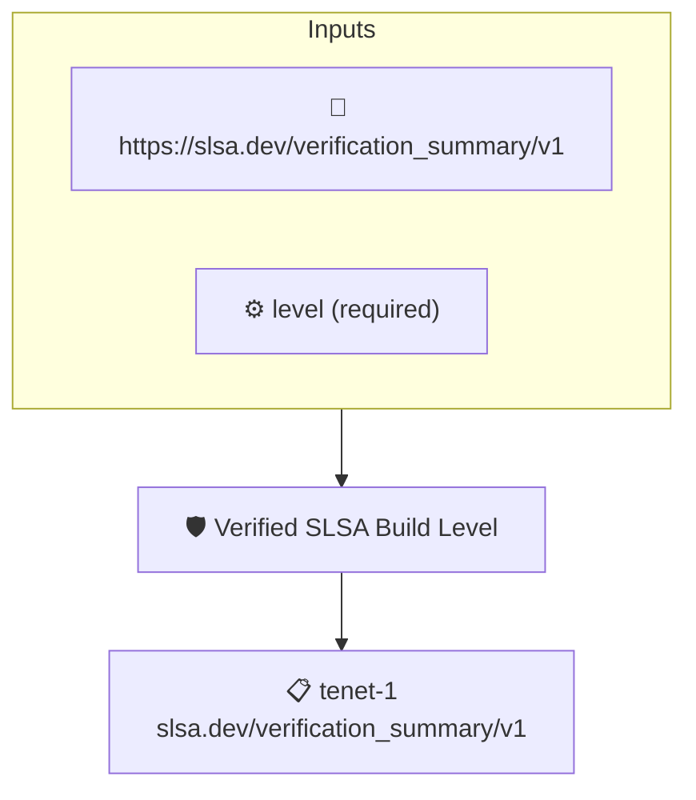

# Verified SLSA Build Level

Checks that a SLSA Verification Summary Attestation records a passed verification at the expected SLSA Build level for the artifact.

## Overview

| Property | Value |
|----------|-------|
| **Type** | Policy |
| **ID** | `vsa-slsa-build-level` |
| **Assert mode** | AND |
| **Tenets** | 1 |
| **Enforce** | ON |

## Context Values

| Name | Type | Required | Default |
|------|------|----------|---------|
| `level` |  | **yes** |  |

## Structure



## Tenets

### Tenet: `tenet-1`

**Attestation types:**
- `https://slsa.dev/verification_summary/v1`

**Evaluation:**
```cel
outputs.pass && outputs.levels.exists(k, v, (v == 'SLSA_BUILD_LEVEL_3' || v == 'SLSA_BUILD_LEVEL_4') )
```

**Outputs:**
- `levels`: `has(predicates[0].data.verifiedLevels) ? predicates[0].data.verifiedLevels : [] `
- `pass`: `has(predicates[0].data.verificationResult) ? predicates[0].data.verificationR...`

**On pass:** VSA attesting a SLSA_BUILD_3 compliance verification

**On fail:** SLSA Build L3 not recored in verification summary

